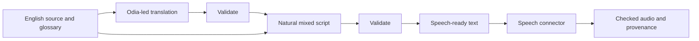

# Current prototype milestone

The screen-reader and beginner checkpoint flow now work in the private hosted Worker prototype. The Python/FastAPI implementation is consolidated with mixed-language text/audio job routes and locally verified; its cloud origin is not yet connected.

Start with [screen-reader baseline v1](docs/baselines/screen-reader-v1.md), [frontend API handoff](docs/handoffs/frontend-api.md), and [the active plan](docs/plans/active.md). Earlier implementation-status passages below are historical; these current documents take precedence. Latency experiment branches are prepared separately, with no new trial/deployment during this pause.

# Kiki Backend

Kiki helps engineering students understand their course material in a familiar language while learning the English terminology they need for exams and practical work. This repository owns the content, media, learning-evidence and guidance capabilities behind that experience. The first language pair is **Odia–English**, with ECE as the initial subject context.

**Current stage:** working translation and speech prototypes, with the backend architecture agreed. **FastAPI** and a **worker/actor hierarchy** are the chosen direction. There is no running FastAPI service yet; backend implementation is paused while the next feature boundaries and acceptance criteria are worked out.

## Start here

| Document | Purpose |
| --- | --- |
| [Active plan](docs/plans/active.md) | Actual progress, checks, unresolved issues and exact continuation |
| [Chosen translation/audio pipeline](docs/decisions/0001-mixed-language-audio-pipeline.md) | Accepted flow, learner inputs, provider evidence and quality boundaries |
| [FastAPI architecture](docs/architecture/mixed-language-fastapi.md) | Job/actor ownership, caching, retries, scaling and WPM assessment |
| [Graphics and annotation handoff](docs/handoffs/graphics-and-annotation.md) | Next-session investigation of generated graphics and both pointing modes |
| [Setup guide](SETUP.md) | Current runtime needs, credentials and optional service references |
| [Agent instructions](AGENTS.md) and [context boot](CONTEXT-BOOT.md) | How a new session loads context and waits for direction |

## Feature directions

These are connected product capabilities, with separate contracts and evidence requirements. The full rationale is in the [seven prototype directions](context/design-thinking/docs/prototypes/backend-prototype-directions.md); current user decisions and backend documents take precedence over older implementation suggestions there.

| Direction | Intended functionality | Current state |
| --- | --- | --- |
| **1. Grounded bilingual lesson compiler** | Turn source material into cited concept explanations, examples, recap and practice; retain scientific facts and English terminology across language variants | English-paragraph translation/mixing prototype exists; upload/extraction and full lesson compilation remain planned |
| **2. Mixed-language speech** | Narrate the actual mixed explanation, expand equations/units correctly, support term pronunciation and eventual highlighting | Real Gemini speech connector and recordings exist; pronunciation review and trustworthy timing cues remain pending |
| **3. Graphics generator** | Produce scientifically controlled, editable diagrams and explanatory animation, with still-image and GIF exports | Next feasibility/design workstream; no graphics engine implemented |
| **4. Annotated teaching canvas** | Point, highlight, draw and write on diagrams or uploaded pages in sync with narration | Contracts and synchronization need investigation; audio alignment is a dependency |
| **5. Learner graph and adaptive curation** | Track separate concept, terminology, English-expression and practical evidence; choose a useful next activity | Source contracts and proposed policies exist; backend evidence/curation loop not built |
| **6. Diagnostic assessment and repair** | Evaluate answers, separate scientific understanding from English expression, annotate handwritten work and offer targeted retests | Product direction and source models exist; runtime assessment/OCR/repair not built |
| **7. Live-screen guidance and labs** | Observe an opted-in tool workspace, point to the next relevant target, verify checkpoints and save progress while the student acts | Simulink Online is the initial tool direction; real observation/overlay access and experiment feasibility remain unverified |

## Chosen translation and audio pipeline



Use native Odia script with English technical terms in Latin letters. The refinement stage checks the original English as well as the translation. Visible formulas and values remain unchanged; the speech-ready representation carries their spoken expansions.

The future endpoint must accept two independent student settings: **`odia_proficiency`** and **`english_proficiency`**, each out of 10. They guide vocabulary and phrasing in both text stages. They are self-reported settings, not measured mastery or a language percentage. The current CLI has one fixed mix setting; the hardened **English 5/Odia 7** prompt is still a VCO-specific experiment, not a general implementation of those endpoint inputs.

Completed VCO and held-out text runs passed automated preservation checks. The speech connector produced real **51.68-second** and **104.8-second** recordings using `gemini-3.8-flash-lite-tts`, Kore voice. The longer recording uses a disclosed translation draft: final refinement returned HTTP 503 and three phrase warnings remain. Scientific meaning, natural Odia and pronunciation still need qualified review. Only full-clip duration is available; sentence/word alignment has not been generated.

Browse the [evidence archive](prototypes/mixed_script/evidence/2026-10-13/README.md) for actual input/output, requests, failures and recordings, or open the owner-private [listening player](https://kiki-vco-listening-draft.woodsycarp256.chatgpt.site). That Site is a separate listening prototype, not a deployed backend.

**Pace:** Gemini supports pacing instructions, but exact numeric WPM compliance is not established and the current connector's style is fixed. A future target WPM must be measured against the generated audio. Student playback speed is a separate control. See the [WPM assessment](docs/architecture/mixed-language-fastapi.md#wpm-and-playback-speed).

## Now / Next / Later

### Now

- Preserve and review the working text/speech pipeline, exact prompts, tests and published evidence.
- Keep the FastAPI/worker design and the graphics handoff as the current implementation direction.
- Resolve scientific/native-Odia concerns without treating an automated structural pass as meaning approval.
- Keep backend building paused until an implementation slice is explicitly requested.

### Next

- Investigate one bounded graphics scene: editable semantic objects, deterministic rendering, a still and GIF export.
- Define pointing/writing on generated scenes and uploaded pages, including transforms, stable targets and real narration alignment.
- Investigate live-screen observation and stale-target cancellation separately from teaching-canvas annotation; verify actual tool access before claiming a connected pointer.
- Generalize/evaluate the two-score language policy, decide the source-input contract, job store/queue, traffic/budget and pace requirements.
- Once building is authorized, expose the existing pipeline through a bounded FastAPI job endpoint with durable checkpoints, owner-scoped assets and separate text/audio readiness.

### Later

- Expand from paragraphs to source-backed lesson packages and more reviewed graphic templates.
- Connect assessment, learner evidence, targeted repair and adaptive next activities.
- Develop the verified lab connection into checkpoint-driven guidance and device resumption.
- Broaden languages, voices, tool integrations, offline media and teacher views when the first slices establish their value and reliability.

## Backend architecture direction

**FastAPI admission → job supervision → per-job coordinator → bounded stage workers → provider adapters.**

The planned coordinator owns source/profile snapshots, progress, dependencies, deadlines, retries and cancellation. Shared workers will execute translation, refinement and speech; durable checkpoints will allow a failed stage to resume without regenerating successful stages. Cache by exact source, profile, prompt, model and speech-setting versions. Keep provider-project quotas and concurrency limits coordinated across replicas.

This is a logical actor hierarchy, not a requirement to allocate a process per job. Queue/actor framework, database, object-storage provider and load targets remain open choices. Future graphics can use a render-worker pool; live guidance retains an interactive session lifecycle. The [architecture assessment](docs/architecture/mixed-language-fastapi.md) records the proposed API shape and tradeoffs.

## Core principles

1. **Ground explanations in sources.** Preserve facts, equations, units, values, negation and ideal-model qualifications. Keep provenance and review status with every artifact.
2. **Keep the student in control.** Language settings are editable; listening or watching is interaction telemetry, not proof of mastery. The student performs lab actions.
3. **Separate evidence dimensions.** Scientific understanding, technical vocabulary, academic English and practical execution must not be collapsed into one score.
4. **Use explicit, versioned contracts.** Stable sentence, term, source and eventual scene/span IDs connect content and media. Snapshot inputs; validate each stage and preserve rejected/draft status.
5. **Measure what actually happened.** Distinguish fixture from live output, automated checks from human review, and measured duration from alignment. Never invent timing cues or imply a mock proves real-tool access.
6. **Retain editable teaching assets.** Keep semantic scenes and annotation layers alongside exports. Image/diagram anchors are stable-source targets; live-screen anchors must expire and be re-observed.
7. **Design for recovery and bounded cost.** Durable jobs, idempotency, stage checkpoints, caching and backpressure precede scaling the worker fleet. Do not bypass a failed validator or retry a configuration error blindly.
8. **Protect ownership and credentials.** Authorize private source/assets at the backend boundary, minimize retained data, keep keys out of Git/logs/prompts and inherit configured network/proxy/TLS policy.

## Setup and offline checks

Use **Python 3.12** and Git for the current prototypes and checks. Their runtime uses the Python standard library; no FastAPI dependency installation or service start command exists yet. FFmpeg is needed when converting recordings or exporting future frame-based media. Node.js 22 is optional for validating the imported JavaScript ledgers; Firebase emulators and Java are conditional future tooling, not prerequisites for the current pipeline.

Clone the private repository with an account that has access:

```sh
git clone https://github.com/Kikiland-ai/kiki-backend.git
cd kiki-backend
```

For an existing checkout, inspect branch/HEAD/status and preserve local work before updating. Use `git pull --ff-only origin main` only on a clean main checkout; do not reset or merge superseded history.

Check the snapshot and run the labelled fixture without credentials or network calls:

```sh
python -B scripts/verify-context.py
python -B scripts/generate-mixed-script.py --mode fixture
```

Run the current test and BB8 checks:

```sh
python -B -m unittest discover -s tests -v
python -B -m unittest discover -s bb8/tests -v
python -B bb8/adapters/reference/bb8.py validate
python -B bb8/adapters/discovery/sync.py --check
```

The latest published local verification passed **25 pipeline tests**, **36 BB8 tests** and all **130 pinned source files**. Tests cover structural preservation, adapters and media integrity; they do not certify translation quality or learning impact. CI workflows currently cover BB8 and product-context/ledger validation, not a deployed API.

### Live provider access

Configure `GEMINI_API_KEY` through the selected runtime's secrets settings. Allow HTTPS to `generativelanguage.googleapis.com` using supported environment configuration; retain its proxy and CA trust. The CLI reads the **process environment** and does not automatically load `.env`. Credentials and access do not transfer merely because another session clones this repo.

Verify actual model generation access in the current runtime before an authorized live trial. The successful text baseline used `gemini-3.5-flash-lite`; subsequent capacity failures show that availability is not guaranteed. The CLI's current default is `gemini-3.8-flash`, so a deliberate model override matters. Example after access is verified:

```sh
python -B scripts/generate-mixed-script.py --mode gemini --model gemini-3.5-flash-lite
```

The text CLI makes two dependent requests, stops on failed validation and has no automatic retries. To save JSON, create an ignored `work/` directory and supply `--output work/<new-name>.json`; existing outputs are preserved. Speech is currently a separate [library adapter](prototypes/mixed_script/speech.py), not a CLI flag. Archived trial drivers are reference code and must not be executed automatically. See the [prototype guide](prototypes/mixed_script/README.md) for details.

## Repository map and continuity

| Location | What belongs here |
| --- | --- |
| `prototypes/mixed_script/` | Existing text/speech implementation, prompt copies and measured evidence |
| `fixtures/mixed-script/` | Bounded source and explicitly synthetic generated fixtures |
| `tests/` | Offline pipeline and adapter boundary tests |
| `docs/decisions/`, `docs/architecture/` | Agreed choices and design proposals, distinct from implemented contracts |
| `docs/plans/active.md`, `docs/handoffs/` | Actual progress and cold-pickup instructions |
| `context/design-thinking/` | Immutable imported product snapshot and source types/components |
| `bb8/`, `.agents/skills/`, `.claude/skills/` | Bundled BB8 reference guidance and host discovery wrappers |
| `scripts/` | Existing CLI and source-integrity check |

Future reconciled runtime schemas belong in `contracts/` when implemented; that directory is not present yet. The [source manifest](context/design-thinking/SOURCE.json) pins `73d16c0d967a5d81dd74f1f28ef0defc48c8a778`. Integrity checks establish unchanged bytes, not that every source file was read. `STARTER-MANIFEST.json` describes the original handoff baseline rather than freezing subsequent work.

New agent sessions follow [AGENTS.md](AGENTS.md) and [CONTEXT-BOOT.md](CONTEXT-BOOT.md): load relevant context, report readiness, then wait for the user's direction. BB8 0.2.2 includes 22 skills, including prompt-design-engineering. Local wrappers and reference mode do not imply native ChatGPT plugin activation; see [BB8 usage](BB8.md).

Update the active plan with actual checks, failures and the exact next action. Preserve source precedence and historical evidence. Commits for this repository use **`arpanvihan5-sketch`**, with the author/committer and authenticated push identity checks required by `AGENTS.md`.
