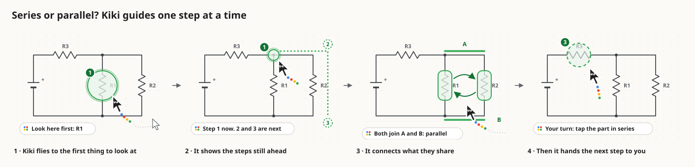
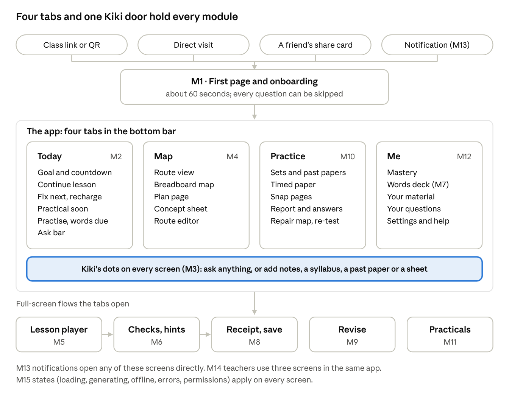
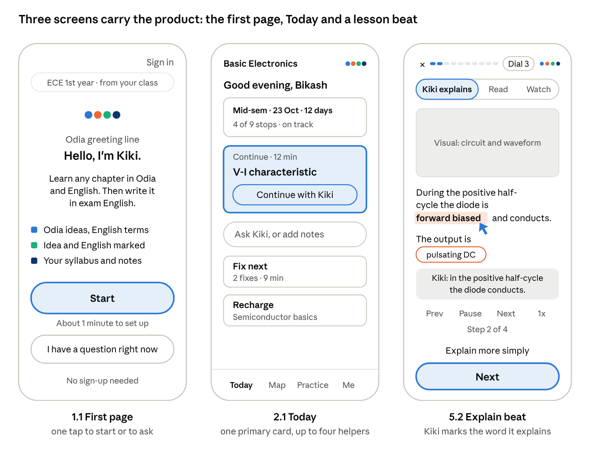
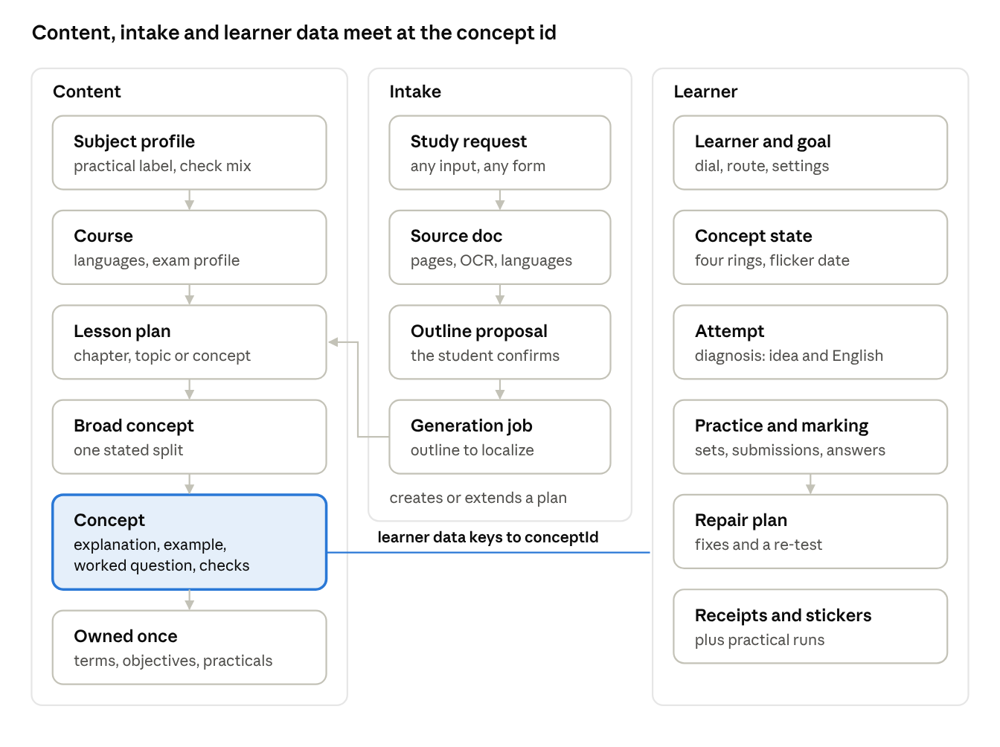
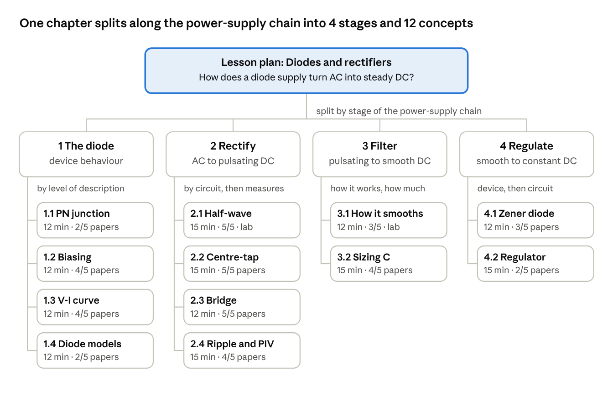

# Kikiland · Design Thinking

The design work for a bilingual (Odia–English) adaptive learning app for first-year engineering students who studied in Odia medium up to Class 12. It teaches every concept in a student-controlled mix of Odia and English, keeps technical terms in English, and marks **the idea and the English separately**, so a student can see when marks were lost to language rather than understanding. Built on Gemini and Google Cloud for the **Google AI Builder Cup** (submission 18 October 2026).

Kiki, the helper, is a companion cursor: it flies to the right part of the student's screen and shows the route one step at a time.



## Status

Day 3 of a 10-day build. The design phase is done; building has not started.

| Area | State |
| --- | --- |
| UX working doc | Done: decisions, onboarding, day-to-day loop, impact plan, UI direction |
| Student journey | Done: 15 modules, every screen, button and state; 11 decisions awaiting team confirmation |
| Feature specs | Done: 31 features, 17 demo-critical |
| Build plan | Done: roadmap with 4 gates, 58 tasks, demo script, risks |
| Data model | Done (v2): any subject, any scope, any input; 3 worked ledgers validated |
| Design system ("Breadboard") | Done: tokens, 25 React components, Kiki guide artwork |
| Clickable demo | Done for the original flow (21 screens); not yet updated to the latest journey decisions |
| App build | Not started |

## What's in this repo

| Path | What it is |
| --- | --- |
| [`HANDOVER.md`](HANDOVER.md) | **Start here.** Everything needed to pick the project up: decisions, links, ids, procedures, next steps |
| [`docs/working-doc/`](docs/working-doc/) | Markdown copy of the five-tab working doc (the live doc is the source of truth) |
| [`docs/diagrams/`](docs/diagrams/) | The working doc's diagrams as PNGs |
| [`data-model/`](data-model/) | Data model v2: TypeScript types, subject profiles, three worked ledgers, validator and tests ([README](data-model/README.md)) |
| [`design-system/`](design-system/) | The Breadboard design system: `project/` (tokens, components, Kiki assets), `tools/build-kiki.js`, and the archived first Kiki set |
| [`prototype/`](prototype/) | The clickable mobile demo (`index.html`) and the Claude Design prompt |
| `AI_Builder_Cup_*.docx`, `Audio Transcript.txt` | The original inputs: product vision, technical architecture, team call |
| [`docs/archive/`](docs/archive/) | An early snapshot of the working doc, superseded |

### Reading order

1. [`HANDOVER.md`](HANDOVER.md)
2. [UX working doc](docs/working-doc/01-ux-working-doc.md): the product decisions and the core loop
3. [Student journey](docs/working-doc/02-student-journey.md): every screen, from the first page on
4. [Feature journeys](docs/working-doc/03-feature-journeys.md): the 31 features as buildable specs
5. [Build plan](docs/working-doc/04-build-plan.md): the 10-day plan and the demo script
6. [Data model](docs/working-doc/05-data-model.md), then [`data-model/README.md`](data-model/README.md)
7. [`design-system/project/README.md`](design-system/project/README.md): the brand book

## Running things

Everything runs with Node 18 or later and a browser. There are no dependencies to install.

```sh
# Validate every lesson ledger, plus the cross-ledger checks
node data-model/validate.js data-model/ledgers

# Seed 13 known errors and check the validator catches each one
node data-model/tools/test-validator.js

# Regenerate Kiki's guide artwork (design-system/project/assets/Kiki/)
node design-system/tools/build-kiki.js

# Rebuild the diode ledger from the archived v1 file
node data-model/tools/migrate-v1-to-v2.js data-model/archive-v1/diodes-and-rectifiers.ledger.json data-model/ledgers/electronics/diodes-and-rectifiers.json
```

**The clickable demo:** open `prototype/index.html` in a browser. It loads React from a CDN, so it needs internet. Voice, camera and sign-in are simulated.

## Key decisions

- **Odia first, student in control.** A five-notch language dial that only the student moves; Kiki may suggest a notch.
- **Colour is a skill.** Blue concept, red technical words, yellow exam English, green lab. Red never means wrong.
- **The X factor.** The student writes exam answers on paper and snaps them. Gemini reads the handwriting and marks the idea and the English separately, then builds a repair map of fixes.
- **The student's material comes first.** Their notes and syllabus are the first source of truth; curated content fills the gaps.
- **Any subject, any input.** One lesson pyramid holds a chapter, a topic or a single question. Every input (question, notes, syllabus, past paper, experiment sheet) comes through one Kiki door and is matched before anything new is generated.
- **Demo scope.** Electronics, chapter "Diodes and rectifiers", with a browser half-wave rectifier lab.

## Diagrams

| | |
| --- | --- |
|  |  |
|  |  |
|  |  |

## Live artifacts

These are private claude.ai artifacts owned by the project lead. Ask them to share access.

- Working doc (5 tabs): https://claude.ai/code/artifact/8ce032fe-a480-4582-85ab-0068f0f57a80
- Breadboard design system: https://claude.ai/artifact/2xtRepczwUyXaNVKP17cuc
- Clickable mobile demo: https://claude.ai/artifact/Xc4Xwxj943pPqT3DiAbziJ

## Notes

- All Odia text is placeholder and needs a native speaker's review.
- Past-paper weights in the diode ledger are sample values. The Chemical Engineering ledger's past papers are illustrative.
- Copy rules: short plain sentences, sentence case, no emoji, "not yet" instead of "wrong".
