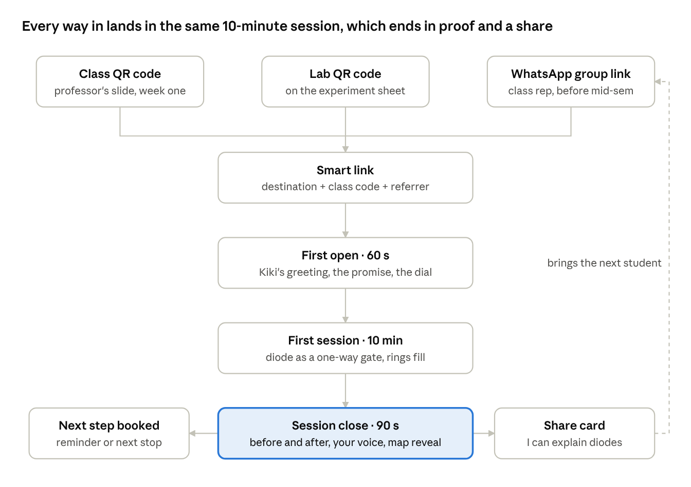
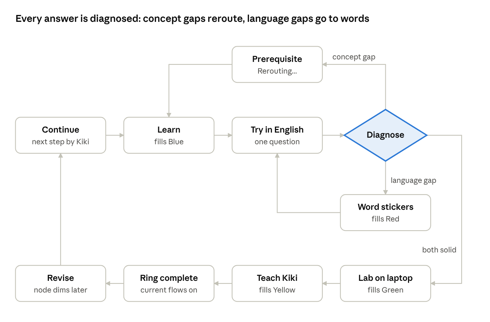

# UX Working Doc — Bilingual STEM Learning (AI Builder Cup)

Oct 10, 2026 · @Arpan

## Decisions so far

The user experience (journey, onboarding, interaction model) was closed on 11 October with all recommendations agreed. User interface work (screens, components, visuals) is in the UI sections at the end.

Every feature, step by step, with the student's actions, the product's responses and the outcome: Feature journeys

| Topic | Decision | Notes |
| --- | --- | --- |
| Subjects | Electronics, Electrical, Chemical Engineering | Matches the team's backgrounds. Exact chapter not fixed yet. |
| First regional language | Odia | Other languages later. |
| Language dial | Student controls it; the system only suggests | The system never moves the dial on its own. Each change is recorded as evidence. |
| Helper character | Kiki | Lab copilot and in-app guide. |
| Product name | None for now | Revisit later. |
| Visual direction | Google's four colours, playful but not kiddy | Users are 17 to 19 year-old engineering students. |
| Sequence | UX first, then UI | This doc tracks both as we iterate. |
| Demo scope | One branch, in depth: Electronics, "Diodes and rectifiers". | Electrical and Chemical appear on the branch picker as "coming soon". |
| Student's own material | Their notes and slides are the first source of truth; curated content fills gaps. | From the team call. Feature 19 in Feature journeys. |
| X factor | Snap your answer: handwritten exam answers marked with concept and English separated. | Closes the demo. Runner-up: Viva with Kiki. Scale story: class pulse for teachers. |
| Generality | Every feature is a template for any course; the diode chapter is the worked example. | Lab faults use general fault cards (feature 13). |
| Kiki's guide form | A companion cursor, in the spirit of Clicky: a pointer with two eyes that lives beside the student's own cursor or finger and flies to the thing that matters. It shows the route: a halo and a filled number on the step now, ghost numbers on a dashed path for the next two steps, and ticks when done. Its four dots trail its flight path. It also marks words by sweep, marker, lens, connect or circle, in the colour of the skill taught. | Feature 28. Redrawn on 11 Oct as 13 guide moves (look, path ahead, trace, connect, your turn, redirect, show me, ask, done, words, thinking, listening, unsure) plus a series-or-parallel storyboard, in the Breadboard design system's Kiki assets. |
| Exam practice loop | Kiki prompts a written practice set; Gemini reads the handwriting, marks concept and English separately, and builds a repair map of weak spots. | Features 29 and 30. Now the demo's closing moment. |
| Data model and journey | The data model works for any subject and any scope (chapter, topic or one question), and for anything a student brings, through one Kiki door. Every screen is specified in the Student journey tab. | Three worked ledgers in three subjects pass the validator. Eleven journey decisions await confirmation at the end of the Student journey tab. |

## Core UX concepts

The signature idea: Google's four colours are the four mastery dimensions from the architecture doc, and each concept is a ring that fills one colour at a time.

| Colour | Dimension | Student-facing meaning | Filled by |
| --- | --- | --- | --- |
| Blue | Concept | "I understand it" | Lesson checks, answers in any language |
| Red | Technical words | "I know what it's called" | Word stickers, term matching |
| Yellow | Academic English | "I can explain it in English" | English questions, Teach Kiki |
| Green | Practical | "I can make it work" | Lab tasks, debugging |

A right answer in Odia with a weak English answer keeps Blue full and lowers only Yellow. The screen says so: "You understand this. You just need the English words for it."

Supporting mechanics:

- **Concept map as a circuit board.** Concepts are components, prerequisites are wires. Mastery sends current to the next node. It works as a metaphor for all three branches: signals, power and process flows.
- **Route to Mid-sem.** A Google Maps-style blue route through the map, weighted by past papers, with an ETA. A wrong answer triggers "Rerouting…" through a missing prerequisite.
- **Language dial.** Odia-to-English slider on every lesson. Student-controlled. Kiki suggests a step toward English after a run of correct answers.
- **Word stickers.** Collectible term cards (English term, Odia meaning, audio, mini diagram, example sentence). Reused as drag-in chips when writing English answers.
- **Draw your prediction.** The student sketches the expected waveform or curve before running a simulation. The real output is overlaid on the sketch.
- **Detective debug.** A deliberately broken setup. Kiki asks "why" questions before giving any hint.
- **Teach Kiki.** The student explains the concept to Kiki in English, by voice or text. Kiki plays a confused junior.
- **Flickering nodes.** Mastered nodes dim over days. A short revisit with less help relights them (spaced revision).
- **Kiki's form.** Four Google-coloured dots that bounce while thinking, become an arrow to point, form a "?" to ask, and burst on success.

## Onboarding, end to end

Onboarding is one continuous story: a link arrives in a WhatsApp group, the student learns one concept in 10 minutes, and the session closes with proof they learned it plus a card they can share. Setup questions come after the first win, not before it.

We tell it through one fictional student, used in the demo too:

- **Bikash**, first semester, Electronics and Communication, at an engineering college in Odisha.
- Studied in Odia medium through Class 12.
- Basic Electronics mid-sem in 12 days. A diode rectifier lab next week.
- Has an Android phone with patchy data. Uses the college lab laptop for practicals.

Whichever way they come in, students go through the same first open, session and close. The share card at the end is how the next student arrives.

## Step 1: How the link reaches them

Every way in is a **smart link**. It carries the student's class context, so they land on something useful with their details already filled in. Nothing to install: it opens in the phone's browser.

What a smart link carries:

| Part | Example | What it does for the student |
| --- | --- | --- |
| Destination | A concept, a mid-sem route, a lab walkthrough, a word sticker | Decides where they land |
| Class code | College, branch, semester, section | Pre-fills the syllabus and mid-sem date, and shows "38 classmates are on this route" |
| Referrer | The classmate who shared it | The first screen says "Shared by Rohan" |

The domain is to be decided, since there is no product name yet. Shape: `<domain>/route/basic-electronics?class=<code>&ref=<id>`.

The ways a link gets to Bikash:

| Channel | Who shares it | What they share | Where it lands |
| --- | --- | --- | --- |
| WhatsApp class group | Class representative, before mid-sem | "Basic Electronics mid-sem route" | The route, with the first stop open |
| WhatsApp, from a classmate | Any student, at the end of their session | "I can explain diodes in English" card | That concept's mini-lesson |
| Class QR code | Professor, on a slide in the first week | Class code | The branch map with the class pre-filled |
| Lab QR code | Lab instructor, printed on the experiment sheet | That experiment | On a phone: a 5-minute warm-up. On a laptop: Kiki's lab walkthrough |

What the WhatsApp message looks like:

- **A rich preview card.** WhatsApp shows the link's preview image and title. The image has Kiki's four dots, the concept name in English with an Odia subtitle, and "10 min · Odia + English".
- **A pre-written message** in mixed Odia and English. The sharer can edit it before sending.

How the first links get into groups:

- **For a real launch,** we recruit one faculty champion and the class representatives in each section. Before each exam they get a ready-made mid-sem route link. Lab instructors get printable QR sheets, one per experiment.
- **For the hackathon demo,** we open on a mock WhatsApp class group. The class representative's message and preview card are on screen, and we tap it.

Phone-to-laptop handoff for labs works like WhatsApp Web. The lab laptop opens a short address and shows a QR code. Bikash scans it with the phone, which is already signed in, and the laptop session joins their account.

## Step 2: First open, the first 60 seconds

Bikash taps the class representative's link. Within 60 seconds there is a greeting from Kiki, a clear promise of what the next 10 minutes will achieve, a language choice, and one "before" question. There is no sign-up, no form and no install prompt.

1. **Kiki arrives (0 to 2 s).** Kiki's four dots bounce in and join up while the page loads. The page is kept light so it loads on slow data.
2. **"Tap to hear Kiki" (2 to 10 s).** Browsers block sound until the user taps, so the first tap is the greeting. Kiki speaks in Odia, with the words on screen: "Namaskar! I'm Kiki. Rohan shared your Basic Electronics mid-sem route." Under it: "Shared by Rohan · 38 classmates on this route".
3. **The promise (10 to 30 s).** A route preview: "Mid-sem in 12 days · 9 stops · First stop: Diode, 10 min". Under it, today's goal as a can-do sentence: "In 10 minutes you'll be able to explain in English why a diode lets current flow only one way." A big blue Start button, and a small "Show me the whole map" link.
4. **"Which feels easy?" (30 to 50 s).** One Class 12 sentence about electric current, shown three ways: mostly Odia, mixed, mostly English. Bikash taps one and the dial is set. Kiki points to the dial: "You can change this any time."
5. **The "before" question (50 to 60 s).** Kiki: "What do you think right now? No marks." One question on today's goal, in English, with "I don't know yet" as a valid answer. Kiki cheers whichever they pick. This answer is saved for the before-and-after at the end of the session.

What the class code saved: college, branch, semester, syllabus and mid-sem date are already known, so Bikash never sees those questions.

## Step 3: The first session

The first session is one concept in about 10 minutes: the diode as a one-way gate, which builds on Class 12 semiconductors. A progress bar along the top shows the four ring colours filling as Bikash goes.

| Beat | Time | What Bikash does | What fills |
| --- | --- | --- | --- |
| 1. Hook | 30 s | Sees a phone charger and hears Kiki in Odia: "The socket gives AC, but your phone needs DC. Who decides which way current flows?" | Nothing yet |
| 2. Learn | 3 min | Short explanation at the dial position, with forward bias, reverse bias and cut-in voltage as tappable English chips. Drags a voltage slider and watches current flow one way only, with the V-I curve drawing live. Two quick check questions. | Blue |
| 3. Collect | 1 min | Gets three word stickers (forward bias, reverse bias, cut-in voltage), hears each one pronounced, and matches each to its picture. | Red, partly |
| 4. Try it in English | 2 min | Answers in English: "Why does a reverse-biased diode not conduct?" Can drag stickers into the answer. If wrong, Kiki diagnoses concept or language and reroutes. | Yellow, partly |
| 5. Say it | 1 min | Records one English sentence by voice: "A diode conducts when…". Kiki plays it back and points out one word to improve. | Yellow |
| 6. Lab tease | 30 s | Sees the locked green segment: "Build a half-wave rectifier in Tuesday's lab to complete this ring." Kiki offers a Monday-night reminder. | Green stays locked |

Beat 5 matters. Hearing your own voice explain an engineering idea in English is the moment we want Bikash to remember, and it feeds directly into the close.

## Step 4: Closing the session

The close proves learning with evidence, not praise. Bikash sees what they could not do 10 minutes ago and can do now, hears their own English, and leaves with one booked next step. It takes about 90 seconds.

1. **Before and after.** Kiki brings back the "before" question, side by side: "10 minutes ago: I don't know yet. Now: correct, in English." This is the core proof.
2. **Your voice.** Kiki replays the English sentence from beat 5: "You said this, in English."
3. **The ring.** Blue, Red and Yellow fill in turn. The Green outline pulses, locked until the lab.
4. **The map reveal.** The view zooms out to the whole route for the first time. The Diode node lights up, current flows to the next node, and the counter drops from "9 stops" to "8 stops". The full map is a reward here, not a setup screen.
5. **Words learned.** "3 new English words." If the dial moved toward English during the session, Kiki shows that too.
6. **Save it.** "Sign in with Google to keep your ring and route." The account ask comes now because there is something to lose. If they skip, progress stays on this phone.
7. **Share (optional).** An "I can explain diodes in English" card showing their ring, with a pre-written WhatsApp message. This is what brings the next student in.
8. **One next step.** Specific and timed: "Next stop: Diode as a rectifier, 12 min", or "Tuesday lab. 5-minute warm-up on Monday at 8 pm?" with a Remind me button.
9. **Goodbye.** Kiki's dots burst in four colours, with one line in Odia.

**When the session goes badly,** the close stays honest. "Today you found a gap: current and voltage basics from Class 12. That's what today was for." The ring shows only what the evidence supports, and the reroute appears as progress: "1 stop added, 6 min". Rings are never filled to make someone feel good.

**A good session, in measurable terms,** has three parts:

- The can-do goal is met: the "after" answer is correct in English.
- At least one ring colour moved forward.
- A next step is booked, either a reminder or a next stop.

## Arriving without a link

A student who finds the product directly, with no class code, adds only two short taps before the same first session. Everything else waits until after the first win.

1. Kiki greets, then "Which feels easy?" (same as Step 2).
2. **About me:** chips for college, branch and semester. For the demo, only Electronics is active and the other branches say "coming soon".
3. **What do you need?** "Mid-sem is coming", "Lab is confusing", "I'm lost in class" or "Get interview-ready". This picks the first node.
4. The "before" question, then the same 10-minute session and close (Steps 3 and 4).
5. **After the close:** "Make your route exact. Snap your syllabus or past papers." Gemini reads them, past-paper weights adjust the route, and they can pop the English words they already know to fill their sticker deck.

## How students use it day to day

Home is the map, not a feed. Most sessions are one tap on a big "Continue with Kiki" button, which runs the Learning Orchestrator's next step. A goal card sits above the map: "Mid-sem in 12 days. 3 stops left."

A concept gap sends the student back through a prerequisite. A language gap sends them to word stickers and an easier English version. Only answers solid on both move on to the lab.

| Mode | Device | How they enter | What Kiki does | Colours it fills |
| --- | --- | --- | --- | --- |
| Learn | Phone | Continue, or tap a node | Explains at the dial position, checks understanding, diagnoses | Blue, Red |
| Exam | Phone | Goal card or mid-sem date | Shows the route, runs past-paper practice, reroutes on misses | Blue, Yellow |
| Lab | Laptop | "Open on laptop" from a node, or the lab's QR code | Copilot overlay: points at controls, asks for predictions and "why", runs the debug case | Green |
| Revise | Phone | A flickering node or a notification | Two-minute checks with less help and a suggested notch toward English | All four |
| Teach Kiki | Phone, by voice | A ring three-quarters full, or the interview goal | Plays a confused junior, then gives feedback against a rubric | Yellow |

Interaction rules:

- **The dial is always in the lesson header.** The student can drag it any time. Kiki suggests a change with a chip ("3 right in a row. Try one notch more English?"), and the student taps "Yes" or "Not now". Moving toward Odia never costs points. It is recorded as evidence of how much support they need.
- **Kiki is present, not a chat window.** Four dots sit in the corner. Tap or hold to talk, in Odia or English. Kiki answers mostly with actions (a diagram, a simpler version, a hint, pointing at a control) rather than long text.
- **The hint ladder.** Kiki asks a question first, then gives a nudge, then a worked step, and only then the answer. Each rung used is recorded as evidence.
- **Diagnosis drives the next step.** A concept gap sends the student to a prerequisite node ("Rerouting…"). A language gap sends them to word stickers and an easier English version of the same question.
- **Notifications report progress, not guilt.** Examples: "Your Diode node is flickering", "2 stops left before mid-sem", "Lab tomorrow: 5-minute warm-up?". There are no streak warnings.
- **Mastery view.** Four colour bars per subject, a weekly English-percentage trend, the size of the sticker deck, and milestones such as "First concept without Odia". A weekly card can be shared to WhatsApp, which feeds back into acquisition.

## Recommendations on the open questions

Recommended: demo Electronics only, using a "Diodes and rectifiers" chapter that ends in a half-wave rectifier lab inside a browser-based simulator. The other seven answers follow from that choice. Change the status as the team decides.

| Question | Recommendation | Why | Status |
| --- | --- | --- | --- |
| Demo one branch or three? | One branch: Electronics | The lab gives the clearest visual payoff (AC sine wave in, rectified wave out), and the call already named its tools | Agreed |
| Which chapter and first node? | Diodes and rectifiers, about 10 nodes: semiconductor basics, PN junction, forward and reverse bias, V-I characteristic, diode models, half-wave rectifier, full-wave rectifier, filter capacitor, ripple, Zener regulator. First node: the diode as a one-way gate. | Builds on Class 12, appears in first-year Basic Electronics syllabi, and matches the architecture's 10-node target | Agreed |
| Which lab tool? | A browser-based lab that looks like a SPICE simulator, with 5 to 10 known screen states. Kiki still reads screenshots with Gemini. Debug case: the diode is placed backwards, so only the negative half-cycles appear. Real LTspice is the next step after the demo. | The architecture doc prefers a controlled browser simulation. Nothing to install on college laptops, the demo is reliable, and the draw-your-prediction overlay is easy on our own canvas. | Agreed |
| Is the dial one global setting or set per concept? | One global dial. Moving it inside a lesson applies to that lesson, then Kiki asks "Keep this everywhere?" | One setting is easy to understand. Differences between concepts appear as Kiki's suggestions, not as extra settings. | Agreed |
| Spoken-English listening check in onboarding? | Leave it out. Add listening inside lessons later: Kiki reads an English sentence aloud and the student picks its meaning. | Keeps the first minute short. Listening is better measured on real lesson content. | Agreed |
| Syllabus and past-paper upload in the 10-day scope? | Yes, narrowly. Upload one real syllabus or past paper; Gemini maps it onto our curated graph and counts topics. If parsing fails, fall back to the curated graph silently. | A strong Gemini multimodal moment for judges, kept reliable by the curated graph | Agreed |
| Phone-to-laptop handoff? | A QR code on the laptop, scanned by the signed-in phone, like WhatsApp Web. Google sign-in on the laptop as the fallback. | Lab laptops are shared, so students should not type passwords on them, and the pattern is already familiar | Agreed |
| What if Kiki is unsure what is on screen? | Below a confidence threshold Kiki never guesses: "I can't see clearly. Which screen are you on?" It shows three thumbnails of known states to tap. | Pointing at the wrong control destroys trust. A tap costs 2 seconds. | Agreed |

## Measuring impact

The headline we want to show judges: **the gap between what students know and what they can say in English gets smaller.** We measure concept, English and practical skill separately, as the vision doc asks. None of this has been run yet.

Pilot plan: 10 to 20 Odia-medium first-years. Before the submission if possible, otherwise presented as the planned next step.

| Measure | Before and after the same concept | Dimension |
| --- | --- | --- |
| Concept score | The same question asked in Odia | Blue |
| English answer score | The same question asked in English | Yellow |
| Odia-to-English gap | The difference between the two scores above; it should shrink | Blue against Yellow |
| Handwritten 5-mark answer | Marked with Snap your answer (feature 21) | Blue, Yellow |
| Spoken explanation | One 60-second explanation, scored with the same rubric | Yellow |
| Lab | Completion time and hints used | Green |

Product numbers to track during the pilot: time to the first lesson, session completion, the good-session rate, dial movement toward English over a week, and how many students return after a reminder.

## Student journey and data model

Every screen a student sees is now specified, module by module, in Student journey. For each screen it gives what it shows from top to bottom, every button and what it does, and the states it handles. The first page is screen 1.1.

The data model behind it is subject-agnostic and is described in Data model: one pyramid for a chapter, a topic or a single question, and one intake for anything a student brings. The journey tab ends with 11 decisions for the team to confirm, including four bottom tabs (Today, Map, Practice, Me) and one Kiki door for asking and adding anything.

## UI 1: Creative direction

The concept is **Breadboard: colour is earned**. The app looks like a friendly electronics breadboard drawn on graph paper, and Google's four colours appear only as the student earns them. A new student sees a calm, mostly ink-on-paper app with one spot of colour: Kiki's four dots. By mid-sem, their map is lit up in Blue, Red, Yellow and Green.

Why this direction:

- **It makes progress visible without a single number.** The screen itself becomes more colourful as the student learns, and a glance at the map is a progress report.
- **It belongs to the subject.** Wires, LEDs, current, switches and oscilloscope traces are the native language of Electronics. Loading, success and navigation all borrow from it.
- **It is Google without being a Google clone.** The four colours, Material 3 shapes and Material Symbols carry the brand. The breadboard and Kiki make it ours.
- **It is playful, not kiddy.** Engineering students already love this imagery. It feels like a smart toy, not a children's app.

The breadboard metaphor, element by element:

| UI element | Breadboard meaning |
| --- | --- |
| Dotted 8 px background grid | The holes of a breadboard, and graph paper |
| Concept node on the map | A component plugged into the board |
| Prerequisite line | A jumper wire |
| Mastering a concept | Power on: its LED lights up and current flows down the wire |
| Loading | A pulse of current running along a wire |
| Error or lost connection | A broken wire, and Kiki's dots drift apart |
| Lab mode | An oscilloscope screen: dark glass, glowing traces |
| Recording your English | Your voice drawn live as a waveform on a scope |

Seven principles every screen follows:

1. **Colour is earned.** Brand colour marks progress and Kiki. Everything else is ink and paper.
2. **One decision per screen.** One thumb, one main action, on a phone held in one hand.
3. **Two scripts, one voice.** Odia and English are set as equals. An English technical term always looks the same, everywhere.
4. **Show, then tell.** A picture or an interactive first, words second.
5. **Kiki acts, not chats.** Kiki points, draws, highlights and asks short questions. No long chat bubbles.
6. **Light enough for 3G.** The first screen loads in under 1 MB. No video in the critical path.
7. **Honest feedback.** Rings, counters and celebrations reflect real evidence only.

## UI 2: Foundations

Foundations are design tokens in code from day one. Each Google colour has two values: the bright brand hue for fills, LEDs and Kiki, and a darker shade for text and icons so it stays readable on white.

**Colour**

| Token | Fill | Text and icon shade | Used for |
| --- | --- | --- | --- |
| Blue | #4285F4 | #1967D2 | Concept dimension, primary buttons, the mid-sem route line |
| Red | #EA4335 | #C5221F | Words dimension, stickers, term chips once collected |
| Yellow | #FBBC05 | #9A5500 | English dimension, voice and Teach Kiki. Never yellow text on white. |
| Green | #34A853 | #137333 | Lab dimension, the lab-mode scope trace |
| Paper | #FBFAF7 | — | App background, a warm white |
| Ink | #1F1F1F | — | Main text, lines, unlit components |
| Pencil | #5F6368 | — | Secondary text, unlit wires |
| Grid dot | #E3E1DC | — | Breadboard dots |
| Scope glass | #0E1116 | — | Lab-mode background |

Two deliberate rules:

- **Red never means "wrong"**, because Red means Words. A wrong answer is "not yet": a pencil-grey outline with a gentle shake, never a red X.
- **Green never means "correct"**, because Green means Lab. A correct answer lights up in the colour of the dimension being practised.

Check the text shades with a contrast checker before shipping.

**Type.** All fonts are free on Google Fonts. Odia glyphs look smaller than Latin at the same size and need room for vowel marks above and below, so Odia is set 2 px larger with more line height.

| Role | Latin | Odia | Size and line height (Latin / Odia) |
| --- | --- | --- | --- |
| Display, headings | Baloo 2 | Baloo Bhaina 2 (same family) | 28/34 · 30/42 |
| Body | Noto Sans | Noto Sans Oriya | 16/24 · 18/30 |
| English term chip | Noto Sans SemiBold | — | 15/20 |
| Values, units, code | Roboto Mono | — | 14/20 |

**Shape.** Material 3 Expressive throughout:

- Buttons are full pills with a 3 px darker bottom edge, like a keyboard key, that presses down 2 px on tap.
- Cards use 24 px corners, bottom sheets 28 px, and map nodes are 16 px squircles.

**Motion.** Springy, never slow.

- Tap feedback: 120 ms.
- Small changes: a 250 ms spring.
- Screen changes: 350 ms.
- Celebrations: at most 1.2 s.
- Current flow: a dashed line moving along a wire on a 1.5 s loop.
- With reduced motion turned on, everything becomes simple fades.

**Sound.** Only five sounds, all off with one switch:

1. A soft tap tick.
2. A sticker pop.
3. A rising three-note chime for a correct answer.
4. A low power-on hum when a concept is mastered.
5. Kiki's voice, which always waits for a tap.

**Haptics.** Short vibrations on Android:

- 10 ms on each dial notch.
- 30 ms on a correct answer.
- A short pattern when a concept is mastered.

**Icons and illustration.**

- Icons are Material Symbols Rounded. Their fill axis animates from outline to solid when something is earned, so icons follow "colour is earned" too.
- Illustrations are ink line drawings with flat fills, in the spirit of Google Doodles. Circuits are drawn as clean schematics.
- Kiki is the only character.

## UI 3: Signature components

Twenty-eight custom components make the product unique, and 17 of them are demo-critical. The nine added for features 13 and 19 to 27 are in the second table. Everything else comes from Material 3 (UI 4). Design effort goes here, in this order.

| Component | What it is | Key states | Priority |
| --- | --- | --- | --- |
| Kiki | Four Google-coloured dots. Docked bottom-right on the phone, floating on the laptop. The dot of the dimension in play leads the group. | Idle (breathing), listening (equaliser bars), thinking (wave), speaking (pulses with the voice), pointing (dots line up into an arrow), asking (dots form "?"), celebrating (burst), unsure (dots drift apart) | P0 demo-critical |
| Mastery ring | Four segments around a node or the profile picture. Sizes: XS on the map, M in the lesson header, XL at the session close. | Empty, partly filled per segment, locked segment (dashed with a lock), flickering (dimming), complete (spins once and glows) | P0 demo-critical |
| Language dial | A slider with 5 notches, from "Odia with English terms" to "English with Odia on tap". The thumb is a potentiometer knob. Five fixed levels keep generated content and grading consistent. | Set, Kiki's suggestion (a ghost knob on the suggested notch with a "Try?" chip), dragging (a live preview sentence) | P0 demo-critical |
| Term chip | Every English technical term, always in the same pill with a dotted blue underline. Tapping it opens a sheet with the Odia meaning, pronunciation, a mini diagram and an example. | New (dotted), collected (red dot), owned (solid, once mastered) | P0 demo-critical |
| Morphing text | The lesson paragraph that re-renders when the dial moves. Term chips stay fixed like anchors while the words around them cross-fade between Odia and English. | Static, morphing | P0 demo-critical |
| Lesson player | A vertical stack of full-screen beat cards, with a progress bar segmented in the four colours and Kiki docked. Card types: Hook, Explain, Explorable, Check, Collect, Try in English, Say it, Lab tease. | Per card: in progress, answered, skipped | P0 demo-critical |
| Explorable | An interactive simulation: a schematic, one slider and a live plot, with current shown as dots moving through the wires. The first one is the diode V-I playground. | Idle, dragging, "aha" (Kiki highlights the knee of the curve) | P0 demo-critical |
| Answer composer | An English text field with the sticker tray underneath. Tap or drag a sticker to insert the term. Mic button, and "Help me start" for a sentence starter. | Empty, typing, terms inserted, submitted | P0 demo-critical |
| Diagnosis card | A split result, for example "Concept: yes. English: not yet", with one action: practise the words, or go to the prerequisite ("Rerouting…"). | Both solid, language gap, concept gap | P0 demo-critical |
| Voice scope | A big mic key over a small oscilloscope screen that draws the student's voice live. Playback, then Kiki highlights one word to improve. | Ready, recording, playback, feedback | P0 demo-critical |
| Learning receipt | The session close: before-and-after cards, voice replay, ring fill, map zoom, save, share and next step, in that order. | Good session, honest "found a gap" version | P0 demo-critical |
| Breadboard map | A pannable board of concept nodes as components, each with an XS ring and an LED, joined by wires. Shows current flow, a past-paper heat badge and Kiki as the "you are here" pin. | Node: locked, available, in progress, mastered, flickering | P0 demo-critical |
| Prediction canvas | A grid the student draws their expected waveform on, by finger or mouse. The real waveform then draws over it, with a message like "Close! You missed the flat part." | Drawing, revealing, compared | P0 demo-critical |
| Lab copilot overlay | On the laptop: dims everything except a spotlight on the target control, with a step card and a stepper (Predict, Act, Observe, Explain, Debug). Fallback: "I can't see clearly" with three thumbnails to pick from. | Guiding, waiting, asking why, debugging, unsure | P0 demo-critical |
| Route overlay | A Google Maps-style blue route through the map, with stop pins, an ETA pill ("8 stops · 6 h 40 min") and a "Rerouting…" toast that redraws the line. | On route, rerouting, arrived | P1 demo nice-to-have |
| Word sticker and deck | A collectible card that flips to show the Odia meaning and an example sentence. The deck is a grid with counts. | New (shine), collected, owned | P1 demo nice-to-have |
| Share card | An image for the WhatsApp preview and in-app sharing: the ring, "I can explain diodes in English" and an Odia subtitle. | One template per milestone | P1 demo nice-to-have |
| Goal card | "Mid-sem in 12 days · 8 stops left", sitting above the map. | Counting down, exam day, done | P1 demo nice-to-have |
| Pairing QR | A WhatsApp Web-style QR code and short code on the lab laptop. | Waiting, paired | P1 demo nice-to-have |

| Component | What it is | Key states | Priority |
| --- | --- | --- | --- |
| Source tag and "What I found" | A tag on lesson cards ("From your notes, page 7") that opens the page snippet, plus the review checklist matching extracted topics to nodes | Reading, review, matched, conflict note | P0 demo-critical |
| Snap camera and answer overlay | A camera with a page-edge guide. The student's own photo comes back with blue ticks for concept and yellow underlines for English. Tapping a mark opens the Odia explanation. A rewrite view | Capturing, reading, marked, unreadable lines, mark range | P0 demo-critical |
| Fault card panel | The debug challenge card: symptom, Kiki's "why" questions, and the fixed check | Planted, investigating, hint, fixed | P0 demo-critical |
| Viva examiner | Kiki in examiner mode: a spoken question card, the voice scope, a silence timer, rephrase and the Odia fallback | Asking, listening, rephrasing, result | P1 demo nice-to-have |
| Watch player | Slides with narration and captions, term chips in sync with speech, and the dial working mid-play | Playing, paused on a chip, ended with a check | P1 demo nice-to-have |
| Tour spotlight | The copilot overlay reused for the software tour, with one tiny task per panel | Panel n of m, task, done | P1 demo nice-to-have |
| Class pulse bar | A three-part bar per node (mastered, language gap, concept gap) and a node drill-down with misconceptions and actions | Class view, node view, hidden under 10 students | P1 demo nice-to-have |
| Report sheet | A long-press sheet: wrong meaning, bad Odia, wrong science, other, optional voice note | Reporting, reported, fixed | P2 after hackathon |
| Offline pack chip | A download chip showing the size, plus a badge on queued answers | Available, downloading, ready offline, queued | P2 after hackathon |

## UI 4: Standard components and system states

Everything that isn't signature comes from Material 3, restyled with our tokens. Don't design these from scratch.

- **Buttons:** filled pill (the tactile key), tonal, text, icon button. One filled button per screen.
- **Chips:** choice chips (branch, goal) and filter chips (sticker deck).
- **Bottom sheet:** term details, dial explainer, share options. Used instead of dialogs on the phone.
- **Navigation bar:** three tabs only: Map, Stickers, Me. Lessons open full screen over it.
- **Snackbar:** "Saved", "Rerouting…", "Back online".
- **Linear progress:** the segmented four-colour version in the lesson player.
- **Text field:** the base of the answer composer.
- **Top app bar:** small, holding the dial and close button inside lessons.
- **Switch:** sound on or off, reminders.

System states, in the breadboard voice:

| State | What the student sees |
| --- | --- |
| Loading | A pulse of current runs along a wire. Kiki's dots breathe. Skeleton cards keep the layout steady. |
| Offline | A thin banner: "No signal. Your progress is saved on this phone." Cached lessons and stickers still work. |
| Error | A broken-wire illustration, Kiki's dots drift apart, and one action: "Try again". No error codes. |
| Empty | An unplugged board with one glowing hole: "Your first component goes here", and a Start button. |
| Permission (microphone) | Kiki explains in Odia why it needs to hear them before the browser asks. |
| AI is slow | Kiki says "Thinking…" with the wave animation. After 4 s, a pre-generated fallback appears. |

## UI 5: Screen inventory

The demo needs 28 screens: 22 on the phone and 6 on the laptop. Four are hero screens that get the most design time, because the judges will remember them. Hero 4 is Snap your answer (screen 23), in the second table.

- **Hero 1: Lesson with the dial (screen 7).** The paragraph morphs from Odia to English while the term chips stay put. This is the unique pedagogy in one gesture.
- **Hero 2: Learning receipt (screen 12).** Before-and-after, the student's own English voice, and the map lighting up. This is the proof of learning.
- **Hero 3: Lab with Kiki (screen 17).** Draw your prediction, then Kiki spotlights the tool and the real waveform overlays the sketch. This is Gemini seeing the screen.

| # | Screen | Device | Built from |
| --- | --- | --- | --- |
| 1 | WhatsApp class group (demo mock) | Phone | Share card preview |
| 2 | Tap to hear Kiki | Phone | Kiki, greeting text |
| 3 | The promise | Phone | Goal card, route preview, can-do sentence |
| 4 | Which feels easy? | Phone | Three sentence cards, dial introduction |
| 5 | The "before" question | Phone | Check card with "I don't know yet" |
| 6 | Lesson: Hook | Phone | Lesson player, illustration, Kiki speaking |
| 7 | **Lesson: Learn (Hero 1)** | Phone | Morphing text, term chips, dial, diode explorable |
| 8 | Lesson: Collect | Phone | Word stickers, match game |
| 9 | Lesson: Try in English | Phone | Answer composer, diagnosis card |
| 10 | Lesson: Say it | Phone | Voice scope |
| 11 | Lesson: Lab tease | Phone | Mastery ring with Green locked, reminder chip |
| 12 | **Learning receipt (Hero 2)** | Phone | Before-and-after cards, voice replay, XL ring, map zoom, share, next step |
| 13 | Map with route | Phone | Breadboard map, route overlay, goal card |
| 14 | Sticker deck | Phone | Word stickers, filter chips |
| 15 | Me (mastery view) | Phone | Rings per subject, English trend, milestones |
| 16 | Pair this laptop | Laptop | Pairing QR |
| 17 | **Lab: Predict (Hero 3)** | Laptop | Prediction canvas, copilot overlay |
| 18 | Lab: Act, observe, debug | Laptop | Spotlight, stepper, scope output, "I can't see" picker |
| 19 | Lab complete | Laptop and phone | Green fills, power-on, phone ring updates live |

| # | Screen | Device | Built from |
| --- | --- | --- | --- |
| 20 | Add your notes and "What I found" | Phone | Upload picker, source tag review |
| 21 | Lesson card with a source tag | Phone | Lesson player, source tag |
| 22 | Snap: question and camera | Phone | Question card with the marking scheme, Snap camera |
| 23 | **Snap result (Hero 4)** | Phone | Answer overlay, Odia explanation sheet, rewrite view |
| 24 | Viva with Kiki | Phone | Viva examiner, voice scope |
| 25 | Watch mode | Phone | Watch player |
| 26 | Report a problem | Phone | Report sheet |
| 27 | Software tour | Laptop | Tour spotlight |
| 28 | Class pulse (teacher) | Laptop | Class pulse bar |

Screen 19 is a small showpiece. When the lab finishes on the laptop, the phone on the table lights up its Green segment at the same moment.

## UI 6: How we build it

The full plan is in the Build plan tab: the roadmap with four gates, a 49-task checklist, the demo script, and risks with fallbacks. The tools below are the suggested stack.

The components are built and live in the [Breadboard design system](https://claude.ai/artifact/2xtRepczwUyXaNVKP17cuc): tokens, 21 interactive components with guidelines, and a React-ready bundle (`window.Breadboard`). Local copy: `design-system/project/` in the project folder. Two text shades were darkened there to pass contrast checks: yellow text is #9A5500 and green text #137333.

Suggested tools, for the team to confirm:

| Need | Tool | Why |
| --- | --- | --- |
| App and tokens | React with Tailwind, tokens as CSS variables | Fast to build, and tokens stay in one place |
| Spring motion | Motion (formerly Framer Motion) | Springs and layout animation built in |
| Kiki | Plain SVG circles animated with Motion | Four dots need no Lottie or Rive files |
| Breadboard map | React Flow, with custom nodes and animated edges | Pan, zoom and wires out of the box |
| Explorable and waveforms | Hand-written SVG | Small, and fully under our control |
| Prediction canvas | perfect-freehand | Smooth finger strokes |
| Icons | Material Symbols Rounded, variable font | The fill axis animates "earned" |

Two rules for the whole build:

- **Test on a cheap Android phone from day 3.** Check that Odia conjuncts render correctly in our fonts, and check load time on throttled 3G.
- **Every AI moment in the demo has a cached fallback.** The live call runs, but the demo never waits more than 4 s.

## UI 7: Open questions

- [ ] **Kiki's Odia voice.** Check whether Google Cloud Text-to-Speech or Gemini speech supports Odia at good quality. Fallback: a team member records the demo lines.
- [ ] **How Kiki addresses the student.** Familiar Odia (like a friendly senior) or formal? Proposal: familiar, which suits the elder-sibling tone.
- [ ] **Showing English as a percentage.** It could feel like a grade. Alternative: show only the dial position and the count of words owned.
- [ ] **Dark mode.** Proposal: lab mode only for the demo. A full dark theme for late-night hostel study comes after the hackathon.
- [ ] **Map on a 360 px phone.** Can 10 nodes stay readable side by side, or should the phone map be a vertical board that scrolls?
- [ ] **Illustrations.** Hand-draw 6 to 8 key illustrations, or generate them with Google's image models in one fixed style?
