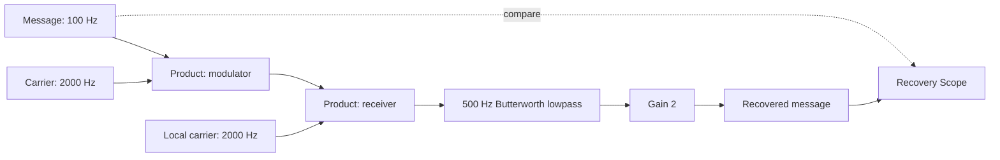

# DSB-SC guided Simulink prototype: source analysis and tracking schema

14 October 2026 (Asia/Calcutta) · Design and checked schema proposal; guided tracker integration remains next

## Outcome and current evidence

The user confirmed the private selected-frame analyzer works, chose Simulink Online, and requested focusing the demo on the supplied Analog Modulation package. The desired session loop is: observe their real experiment, state what to do now and next, keep progress, and preserve useful behavioral/conceptual evidence. This document completes the requested analysis and schema design. It does not claim a completed real Simulink run, live step tracker, overlay or access to frames from this chat.

Use BB8 architecture in reference mode. The pinned product snapshot in context/design-thinking remains unchanged. Read the user's two Markdown guides and then the actual two JSON datasets at upstream commit **2a6c843448d81062f89596b941516f8b7817ec79**:

- [lesson-ledger/v2: analog-modulation.json](https://github.com/Kikiland-ai/Design-Thinking/blob/2a6c843448d81062f89596b941516f8b7817ec79/data-model/ledgers/electronics/analog-modulation.json), Git blob 7e54eabba9aee6108bf0f3d3b742fb8e6da1c797.
- [learning-case/v1: analog-modulation-odia.json](https://github.com/Kikiland-ai/Design-Thinking/blob/2a6c843448d81062f89596b941516f8b7817ec79/data-model/cases/analog-modulation-odia.json), Git blob 78b47d2e7cd4f84b7f7f586f4af5dcfa6631acee.

The guides' documentation-only availability warning is historical: these two JSONs are now published and accessible. They were re-fetched at the exact commit and compared semantically with the initial main-branch reads. Local raw copies are ignored work/dsb-sc-source-{0,1}.json, not an unrequested refresh of the pinned product snapshot.

## What the two JSONs own

The ledger owns the chapter, ten concepts, objective/term/check references and canonical Practical **PR-AM-DSB**. The case joins by courseId CRS-AC-ECE, lessonPlanId LP-ANALOG-MODULATION and practicalId PR-AM-DSB; it adds bilingual instructions, readiness policy, precise block parameters/connections, checkpoints, pointer expectations, faults, viva and synthetic session fixtures.

All twelve ledger steps align exactly with the case's stepNumber, English instruction and expected checkpoint. The canonical dependency graph is a single chain CP-DSB-01 through CP-DSB-12. There are ten blocks and eleven connections. The existing seed session has a currentCheckpointId, status, evidence, observations and revision, but no per-step visits, detailed criteria, dwell-time events or derived execution queue. Both seed sessions have empty evidence/observations. Seeds are explicitly synthetic and cannot establish this user's readiness/progress.

The chapter is broader than the selected lab. The demo is **DSB-SC modulation and coherent demodulation**, not the whole AM/FM/PM chapter. Required concepts are C-AM-01, 02, 03, 04, 06, 07, 08. Normal learner execution requires their concept checks at 60%; the 80% chapter test is separate and not a gate. Their draft estimates are 118 minutes for the chapter and 40 for the lab, not measured user timings. Content/Odia review and actual simulator execution remain draft/unverified in the source.

## The bounded experiment

The student builds the signal path:



Three continuous time-based Sine Wave blocks, two multiplication Product blocks, a continuous Transfer Fcn, Gain and three Scopes. Scope input counts are 2/1/2. No special communications modulation block, channel noise, spectrum analyzer, FM/PM receiver or carrier-recovery loop is required by this basic-block demo.

| Setting | Authored baseline |
| --- | --- |
| Message | Amplitude 1; Bias 0; Frequency 2*pi*100 rad/s; Phase 0; SampleTime 0 |
| Transmitter and local carriers | Amplitude 1; Bias 0; Frequency 2*pi*2000 rad/s; Phase pi/2; SampleTime 0 |
| All sources | Time based; use simulation time |
| Transfer Fcn | Numerator [9869604.40109]; denominator [1 4442.88293816 9869604.40109] |
| Recovery Gain | 2 |
| Simulation | Variable-step ode45; StopTime 0.1 s; MaxStep 1e-5 s |
| Predicted recovery | Approximately 100 Hz, amplitude 0.9992 and 16.4° filter lag after startup; finite residual ripple allowed |
| Deliberate fault | Only local Phase changes from pi/2 to pi: 90° relative error; rerun and compare |
| Restore | Local Phase pi/2; new run and output check; save and explain |

The sidebands 1900/2100 Hz are theoretical expectations, not a requirement to add spectrum measurement to the demo. The ideal message component scales with cos(relative phase); the 90° fault suppresses it while finite-filter residuals can remain. The frequency-mismatch and 50 Hz lowpass faults are optional later trials; only F-AM-PHASE is selected now. Correct product wiring and every parameter still need actual screen/adapter evidence.

## The complete checkpoint ledger

| ID | Student action | Evidence required before marking done |
| --- | --- | --- |
| CP-DSB-01 | Confirm the selected model workspace | Correct model/workspace confirmed; named/saved external model reference recorded |
| CP-DSB-02 | Place Message and Carrier | Both Sine Wave blocks present and identifiable |
| CP-DSB-03 | Set source parameters | Both parameter dialogs reviewed for time mode, amplitude/bias, frequency units, phase and sample time |
| CP-DSB-04 | Connect transmitter Product | Distinct Message/Carrier input connections; multiplication; no added carrier-offset path |
| CP-DSB-05 | Build local carrier and receiver Product | Local source parameters matched; correct two-input receiver wiring |
| CP-DSB-06 | Add lowpass and Gain 2 | Both coefficient arrays, gain and complete receiver chain verified |
| CP-DSB-07 | Connect/label observation scopes | Scope port counts and all original/modulated/recovered signal connections checked |
| CP-DSB-08 | Set simulation settings | Positive visible evidence for stop time, solver and max step |
| CP-DSB-09 | Run baseline | Positive completed-run evidence tied to this workspace/parameter revision; errors resolved |
| CP-DSB-10 | Inspect/record recovery | Readable steady-state output and recorded comparison; allow expected phase lag/ripple |
| CP-DSB-11 | Try phase fault | Local phase pi, transmitter unchanged, completed fault run, baseline/fault comparison and student observation |
| CP-DSB-12 | Restore, rerun, save, explain | Restored parameter, new run, recovered output, separate save confirmation and student explanation |

Each large checkpoint needs subcriteria. The source's single evidenceKind is a useful label but not a sufficient acceptance schema: CP-05 mixes parameters/structure; CP-11 mixes parameter change/run/waveform; CP-12 mixes all of these with saving and explanation. A single attractive screenshot or model sentence cannot satisfy the bundle. CP-03 may need two dialog frames; keep both references. Missing/hidden/unreadable information stays unknown.

The [demo definition](examples/dsb-sc.demo-definition.json) extracts authored source content without changing its IDs and adds explicitly labelled proposed concept mappings and completion-criterion decomposition. These additions are prototype design, not newly attributed upstream content or instructor-reviewed rubrics.

## Recommended state model

Keep three records with different update patterns:

1. **Experiment definition:** immutable/versioned source content, baseline/fault conditions, dependencies and criteria. Reuse it across runs. Bind sessions to a definition digest and source commit rather than pulling moving main mid-lab.
2. **Session projection:** current queue, per-checkpoint status, workspace/capture state, relevant learner evidence and current guidance. This is the fast current/next view, updated by a reducer from accepted events.
3. **Event/evidence journal:** chronological append-only observations, attempts, questions, reviews, pauses, failures, parameter versions and interventions. It retains what happened even if the current projection changes. It provides later analytics without requiring a predefined use for each neutral event.

Proposed structural contract: [lab-tracking/v1 JSON Schema](../../contracts/lab_tracking.schema.json). [Synthetic full example](examples/lab-tracking.synthetic.example.json) illustrates CP-01/02 done and CP-03 current. It is not this user's state. The schema is a checked proposal, not a live API, reducer, persistence implementation or factual vision verifier.

The queue has current_checkpoint_id, upcoming_checkpoint_ids, done_checkpoint_ids and separate support_items. These are computed projections, not separately writable truths. Checkpoint state contains status, attempt_count, visit IDs, criterion evidence and timing/counters. A revision increments with an accepted change. Save and export the event journal rather than only this latest snapshot.

### Queue behavior

- At most one active canonical checkpoint; its dependencies must be satisfied. The canonical twelve-step chain gives a stable queue while support items can be inserted during the current step without counting as extra lab completion.
- done means all required criteria are satisfied by accepted reviewed/integration evidence. Student reports and unreviewed model suggestions enter awaiting_review; neither silently becomes verified completion.
- When the reviewer accepts every criterion, record completion then advance exactly once. Duplicate event IDs/step checks are idempotent. Pausing/disconnecting never advances the queue.
- Revisiting a checkpoint creates a new visit/attempt rather than erasing earlier work. The queue can return to a prerequisite; affected downstream current-validity becomes needs_recheck as appropriate, while past completed runs remain historical evidence.
- Bind observations and candidate guidance to lab revision, current visit, workspace, capture epoch, parameter revision and condition. A late provider response is retained as a historical result but cannot advance a different visit or overwrite current guidance. Cancel/recheck live guidance on stale inputs or a workspace change.
- Track conditions baseline, phase_fault and restored_baseline explicitly. The intentional phase-fault change must not be diagnosed as an accidental violation of the earlier baseline step. Keep original baseline proof historical and require new evidence for restoration.
- For a normal learner, keep the canonical prerequisites gate. For the builder's integration trial, an explicit operator_trial override may permit guided prototype testing while readiness remains unknown; it never writes fake passes or imports DEMO-BIKASH data. This is a proposed trial mode, not a recorded decision that this user passed or bypassed checks. Pointer remains inactive in this observation/text-guidance prototype.

### Learner and conceptual state

Keep concept, words, English and lab dimensions separate. Unknown is null, not a zero score. Keep self-rated language/confidence separate from assessed performance. Do not copy the fixture's Odia preference or 60% concept passes into this user's record.

Per relevant concept, retain theory-check references, predictions, answer/explanation text, reviewer feedback, self-reported confidence and task-scoped understanding status. Model hypotheses such as possible_rad_s_confusion carry evidence and alternatives and remain candidates until checked. Correct wiring demonstrates a practical action; it does not establish conceptual mastery. Long time on a step could reflect reading, model UI friction, distraction or disconnection. Preserve that uncertainty rather than diagnosing a concept gap from duration alone.

At appropriate transitions, use brief checks already grounded in the source: why 2*pi*f, why the receiver needs a local carrier, why Gain 2, why traces can lag, or what the 90° fault will change. Prediction first, action/result next, explanation after. Link each answer to its question/rubric/concept/version. A targeted answer may support one task without becoming a prerequisite MCQ pass or overall mastery score. Student-selected language remains editable; drafted Odia copy keeps its review status.

## Event telemetry worth capturing now

Record experiment-scoped signals even before an analytics dashboard exists. Do not inflate raw signal collection into inferred learner traits.

Recommended envelope:

```json
{
  "schema": "lab-event/v1",
  "event_id": "server-assigned-id",
  "event_sequence": 42,
  "lab_session_id": "owner-scoped-session",
  "event_type": "help_requested",
  "received_at": "server UTC timestamp",
  "client_elapsed_ms": 143210,
  "actor_type": "student",
  "checkpoint_id": "CP-DSB-03",
  "visit_id": "visit-3",
  "workspace_id": "confirmed-model",
  "capture_epoch": 1,
  "parameter_revision": 2,
  "condition": "baseline",
  "observation_id": "last-observation-or-null",
  "payload": {"question": "Does the frequency box use Hz or rad/s?"}
}
```

This example is illustrative. Server actor/ownership and receipt time are authoritative; client elapsed time is bounded/validated and is not a trusted cross-device clock. Define typed payloads for implemented event types; arbitrary payload blobs are not a production write contract.

Capture these available events:

- Session start/end, selected experiment and definition, workspace confirmation, capture segment start/stop/gaps, pause/resume/disconnection, and model/provider failures.
- Frame receipt IDs/hashes and geometry, admitted analysis context/model/prompt version, source age, visibility/legibility uncertainty, and accepted/rejected candidate evidence. Frame sampling cannot provide unseen clicks, keypresses or the full action sequence.
- Step entry/exit/revisit, check/review result, skipped/blocked checks and their reason, parameter changes actually seen or reported, recorded run attempts/errors, and model-save confirmation.
- Questions, predictions, answers/explanations, help requests, hint exposure/level, terminology/translation help, language changes, and student-reported confidence. Capture correction/retry origins rather than treating every change as an error.
- Intervention proposed/shown/accepted/dismissed, linked to the hypothesis and before/after evidence. This supports later analysis of whether a hint helped.

Compute wall duration, active tracking time, explicit paused time, disconnected/unknown time and intervals with fresh usable observations separately. None is automatically actual focused work time. A background tracker page or missing visual change does not establish user inactivity. Use disjoint intervals to avoid double counting. Store raw boundaries so metrics can be recomputed.

Future patterns include long-step distributions, repeated unit errors, hints followed by successful retries, conceptual answers preceding practical corrections, and where observation fails. Compare step/task and support mode; do not call correlations causal improvements or label a learner from one sample.

A prototype policy can bound one session journal by duration/events/bytes, retain compact metadata and typed responses, and offer an export. Agree a concrete retention policy during implementation; do not promise indefinite storage. No continuous video archive is needed to collect these signals. Selected raw input retention is a separate decision: a hash without retained pixels cannot support later visual re-review. Any capped/truncated history must expose that fact and missing interval; never present partial capture as continuous coverage.

## Connecting to the working receiver

The current private Site already receives frames and produces generic screen-awareness/v1 descriptions. The user confirmed it works. It has no lab ledger, persistent progress or chat-visible live observation tool. Its secure cookies cannot grow into a full twelve-step event history. A browser sharing pixels to Gemini does not automatically deliver them to this ChatGPT conversation.

Smallest next prototype:

1. Add one preselected PR-AM-DSB Lab mode alongside existing capture. Show current instruction/reason, upcoming checkpoint, reviewed criteria and current observations. Preserve the current private audience and student actions.
2. Keep a small owner-scoped lab session/event store, separate from capture cookies and generic analysis state. D1 is a plausible thin hosted-store option; keep its contracts portable to the chosen Python backend rather than adopting the Worker as the whole backend.
3. Pass only the current checkpoint's authored criteria/model parameters plus bounded accepted evidence to the vision adapter. Return candidate criterion states (visible match/mismatch/unknown) with exact source-frame references. Runtime owns queue transitions and canonical now/next text. The model cannot invent steps or award completion.
4. Provide Check this step and an explicit review action. Begin with human-reviewed screen evidence and labelled self-report for run/save claims that capture cannot establish. Store text predictions/explanations next to the step. Choose small-check evidence coverage before auto-advancement.
5. Connect the guided panel or an authenticated read-only session tool to accepted current state. To let this chat follow the screen, expose owner-authorized current session/observation reads and actual retrievable selected evidence; that tool is not currently installed. Alternatively the Site's own guide can respond beside Simulink. Do not claim this chat is seeing the live page until the read path is verified.
6. Preserve lab state across capture restarts. Link each new capture session with a new lab capture epoch, reconnect gap and fresh workspace confirmation. The authoring estimate exceeds the current 30-minute cap. At ten-second periodic analysis, the existing 30-attempt limit may be reached in about five minutes plus latency. Prefer deliberate step checks plus bounded change-triggered admission for this trial; show exhaustion and continue manual/review progress. Any increased provider budget must be explicit and visible rather than silently removed.

No extension/Simulink-origin overlay, autonomous wiring/runs, voice/audio generation, broad chapter assessment UI, multi-device handoff or full production backend is needed to prove this slice. Keep the student in control. Screen/parameter readability and positive run/output evidence on the actual account remain the highest-value live checks.

## Verification and continuation

Observed design checks: both source JSONs parse; exact course/lesson/practical joins; all 12 checkpoint/step instruction/expected/dependency matches; ten unique blocks; eleven valid connections; synthetic seeds kept separate. Independent calculations matched the filter coefficients, 0.999201 amplitude, 16.4164° lag and 1900/2100 Hz sidebands. These are checked predictions, not this user's simulation results.

`python -B scripts/check-lab-tracking-design.py` validates the proposed Draft 2020-12 JSON Schema and explicit synthetic example, then rejects partial bundled completion, self-report promoted to verified, cross-workspace evidence, stale visit guidance, duplicate checkpoint state, learner prerequisite bypass, synthetic real-session evidence, overlapping timing, missing evidence and wrong parameter revision. These are schema/reference checks, not a full reducer, vision-quality test or live app acceptance. It uses the executor's already available jsonschema package and does not install dependencies or call a provider.

Now: source analysis and reusable schema/definition are complete. Next: wire the focused ledger/review/event loop into the receiver, verify it on controlled Simulink-shaped fixtures, then start with the user's real workspace. Later: richer concept adaptation, retained evidence/analytics, reviewed Odia/native scientific content and distinct graphics-overlay proof.

First live checkpoint: open Simulink Online, create/name/save the DSB-SC model and confirm the shared workspace. Next: place Message and Carrier Sine Wave blocks. Later steps depend on reviewed evidence; none is recorded done for this user yet. Keep the live run separate from the explicit fixture example.
