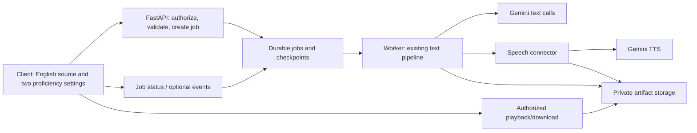
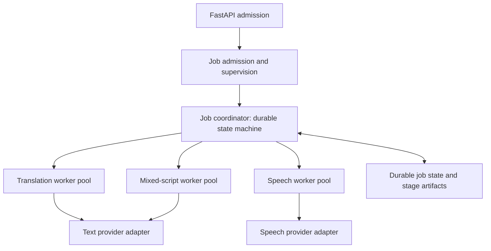

# FastAPI design assessment: mixed-language text and audio

Date: 13 October 2026 · Status: design only; implementation not authorized

> **18 October 2026:** the job API is a content-generation path driven from the database side; kiki-web reads stored content and does not call it. See [ADR 0011](../decisions/0011-generated-content-reaches-kiki-web-through-the-database.md).

The user chose FastAPI and the [translation/audio pipeline](../decisions/0001-mixed-language-audio-pipeline.md), then endorsed a worker/actor hierarchy for job management. The logical hierarchy below is the chosen direction; its concrete runtime, database, queue, storage and performance targets remain proposals.

## Quality attributes and current constraints

Prioritize faithful content, responsive job admission, resumable generation, bounded provider load, separate text/audio readiness, and reproducible artifacts. Expected traffic, account quotas, budget and latency SLOs have not been supplied or measured under load.

The existing text adapter makes two **dependent** network requests; speech adds a third. Translation and refinement cannot run in parallel for the same paragraph. Other jobs can progress concurrently within quota. Observed individual calls include an 11.818-second translation fallback and 23.444-second longer TTS call; that longer run did not complete refinement, so these are **not an end-to-end benchmark**. Capacity failures, a 90-second timeout and quota-zero errors were observed in earlier trials.

The current adapters use blocking `urllib`, and WAV inspection/transcoding also consumes local resources. Do not call these blocking helpers directly inside an `async def` request handler and assume they become asynchronous. FastAPI documents this distinction for ordinary helper functions. [Concurrency guidance](https://fastapi.tiangolo.com/async/).

## Boundary model and options

Start with one codebase and domain pipeline, with separately runnable API and job-worker processes. Keep validation and prompt compilation reusable. A new agent framework or independently deployed service for every stage is unnecessary to expose this deterministic flow.



| Option | Fits when | Main tradeoff |
| --- | --- | --- |
| Bounded synchronous FastAPI call | Internal low-concurrency demonstration with a known request timeout | Least infrastructure, but long provider waits, disconnects and restarts complicate recovery |
| Durable jobs, one codebase, API + workers | User-facing generation with retries, concurrent requests and independent media readiness | Recommended direction; needs persistent state and reliable job delivery |
| Separate text/speech/graphics services | Measured scaling, team or isolation needs justify separate release/ownership boundaries | More network/state/operational complexity; not the first slice |

A database-backed worker queue can minimize initial infrastructure. Alternatively, a durable Redis-backed queue with an appropriate worker library can support more scheduling/concurrency. Postgres is a candidate for job state, unique idempotency keys and transactional checkpoints; Firestore remains an alternative if the wider product adopts it. Choose one authoritative job store. Redis, Celery and Postgres are **not adopted dependencies** by this assessment.

Avoid relying on FastAPI's in-process `BackgroundTasks` as durable generation infrastructure. The official guide points to separate job systems for work distributed across processes/servers. [Background-task guidance](https://fastapi.tiangolo.com/tutorial/background-tasks/).

## Worker and actor hierarchy

Use actors as logical owners of commands/state and workers as the bounded execution capacity. A job coordinator owns one job's transitions; stage-worker pools can execute tasks for many jobs. A logical coordinator does not imply a permanently allocated process or distributed actor instance for every waiting job.



The diagram shows supervision/dispatch ownership, not simultaneous execution of all children. A given job runs translation → validation → refinement → validation → speech. Shared worker capacity serves different jobs concurrently within the applicable quota.

| Role | Responsibility and owned state |
| --- | --- |
| Admission/supervision | Accept durable jobs, enforce owner/project budgets, dispatch eligible work and recover expired worker claims; replicated admission must share quota state |
| Per-job coordinator | Own source/profile snapshots, stage dependencies, attempts, deadlines, cancellation and result readiness; serialize that job's transitions against durable state |
| Stage worker | Claim a versioned task, reuse the existing generator/validator, save its output/provenance and report success/failure; own no hidden authoritative job state |
| Provider adapter | Own provider protocol/authentication, transport limits and safe error classification; do not decide the next stage or alter student settings |

Proposed commands/events include `RunStage`, `StageSucceeded`, `StageFailed` and `CancelJob`, carrying job/stage IDs, attempt ID, input version/hash and artifact references. Reject stale or duplicate completion events with a stage generation/lease token. Save validated outputs and completion state before acknowledging work; schedule the dependent stage through reliable delivery. On restart, reconstruct from saved state and resume the failed/incomplete stage rather than restarting the whole hierarchy.

Process supervision restarts failed worker capacity; the job coordinator decides whether a stage is eligible for retry under its budget. Keep those responsibilities distinct. A queue library may call registered task handlers "actors" without providing durable per-job actor state, so evaluate the actual semantics before choosing a framework. No Ray, Dramatiq, Celery or actor runtime has been selected or installed.

Later graphics rendering can use its own bounded worker pool when a render contract is selected. Live-screen pointing remains an interactive, expiring session coordinator with fresh observations; it is not simply another finite translation-job child. Share execution infrastructure where useful while preserving those lifecycles.

## Proposed endpoint contract

Use a job endpoint such as `POST /v1/mixed-language-jobs`, returning `202 Accepted`, a job ID and a status URL after durable admission. Poll `GET /v1/mixed-language-jobs/{job_id}` initially; add server-sent progress events only if client needs justify them.

Example proposal, **not an implemented schema**:

```json
{
  "source": {
    "content_id": "vco-demo",
    "content_version": "1"
  },
  "profile": {
    "odia_proficiency": 7,
    "english_proficiency": 5
  },
  "audio": {
    "enabled": true,
    "target_wpm": 120
  }
}
```

The source reference resolves to owner-authorized English content, provenance, glossary and protected literals. For a direct-English-text route, require equivalent source/terminology metadata and a bounded deterministic preparation step; do not silently invent citations or treat arbitrary uploaded text as instructions. The prepared-source route reuses the existing input contract most directly. The two ratings are mandatory independent inputs even when the UI initializes them from a saved profile. Snapshot them with the source revision; do not read changing profile state midway through a job.

Proposed input checks: strict finite numeric 0–10 ratings, authenticated source ownership, supported language pair, bounded paragraph/sentence/token size, explicit audio choice, and validated pace settings if supplied. The current text input accepts **1–10 sentences**; its string bound alone is not a total-token budget. Retain that bounded initial unit. Long-document splitting requires separate stable block IDs, source offsets and sentence-aware partitioning around equations/abbreviations; it is later scope.

Keep provider/model/prompt policy server-controlled and versioned. Return requested/applied profile, stage statuses, versioned sentence/spans, source references, validation/review labels, safe failure details and authorized asset references. Return private audio URLs or access-controlled asset IDs, **not multi-megabyte base64 audio in the JSON response**. Expiring URLs must be refreshable for the owner and support ordinary seeking/range requests where the storage/CDN allows it.

## Stage state, failure and idempotency

Proposed progression: `queued → translating → translation_validated → refining → text_ready → synthesizing → ready`. Separate translation, mixed-text and audio status fields remain authoritative when an optional stage fails. Text can be read at `text_ready` without waiting for TTS. A failed refinement leaves a translation **draft**, not `text_ready`. Audio-disabled completion is explicit, not a failure.

Persist each validated stage's output and provenance before admitting its dependent stage. Reuse the completed translation on a refinement retry and the completed script on a TTS retry. Preserve raw candidate/rejected-stage artifacts under restricted retention, while publishing only labelled, validated artifacts. No silent label repair or validator weakening; any later normalization policy needs its own version/evaluation and disclosed transformation.

The existing CLI saves only after both text stages validate. Durable intermediate checkpoints are a future worker responsibility: reuse `make_request`, `GeminiGenerator` and `validate_stage` at stage boundaries, rather than assuming a CLI subprocess already supports restart/resume. The current adapter's safe exceptions also need structured retry categories/hints before implementing the proposed retry policy.

Scope the client `Idempotency-Key` to the authenticated owner and store a canonical request hash. Same key/body returns the original job; same key/different body returns a conflict. Deduplicate simultaneous cache misses with a lease/unique claim, not only a cache lookup. At-least-once worker delivery requires fenced stage claims and atomic completion records so a stale worker cannot overwrite a newer attempt. Bridge the job-write/enqueue gap with a transactional outbox or a database-backed queue.

Use bounded exponential backoff with jitter for eligible transient 503/positive-quota 429 errors, honoring provider retry hints. Set per-stage attempt caps and an overall deadline/cost budget before implementation. Authentication failures, unavailable model eligibility and a zero entitlement need configuration changes, not repeated waiting. Validation errors require a classified repair/evaluation path, not an automatic retry storm. A provider timeout may have incurred work/cost even if no response was received; application idempotency cannot promise exactly-once billing.

Cancellation stops future work and prevents obsolete assets becoming active. Best-effort transport cancellation does not guarantee remote generation stopped. Keep provider attempts in provenance and leave previous successfully saved artifacts intact.

## Making it fast and scalable

1. **Return quickly and expose readiness.** Job admission should do local validation/persistence, not model generation. Measure cold text time, first playable audio, full completion and queue delay separately. No measured SLO exists yet.
2. **Cache at stage boundaries.** Translation keys include exact English/source/segmentation versions, protected glossary/literals, both ratings, profile policy, prompt/schema/validator versions and actual model/configuration. Refinement additionally keys the translation hash. Audio keys the exact spoken transcript, pronunciation policy, provider/model, voice, style/pace, encoding/sample rate and adapter version. Changing pace only should reuse text; changing ratings can invalidate both text stages and downstream audio.
3. **Keep sharing explicit.** Use owner-scoped caches for private inputs. Share reviewed canonical lesson artifacts only under an explicit content-access policy. A content hash is not permission to access another student's notes.
4. **Bound provider work globally.** Separate text/TTS concurrency and token/request budgets per provider project and model; coordinate them across worker replicas. More FastAPI workers cannot create Gemini quota. Google documents rate limits per project rather than per key. [Rate limits](https://ai.google.dev/gemini-api/docs/rate-limits).
5. **Reuse connections and control local work.** Later choose an async HTTP adapter with pooled connections or run the existing blocking adapters in bounded workers. Keep audio decoding/transcoding and future rendering away from API admission. Separate render-worker capacity once graphics CPU/memory measurements justify it.
6. **Stream only after the basic job path is reliable.** The documented TTS API supports streaming PCM, but the current connector consumes a complete WAV. Later streaming needs a client audio buffer, disconnect handling and provisional/completed integrity states; it must not expose unvalidated text. Do not parallelize refinement with its own translation or synthesize a draft and call it the final artifact.

Capacity planning should use actual project RPM/TPM and measured worker occupancy. As a rough upper bound, cold jobs consume two text requests and one TTS request; per-model request limits and input-token limits constrain throughput before CPU scaling. The bound changes with cache hits, model allocation and retries. Measure representative short/long paragraphs and concurrent jobs before choosing fleet size or promising speed.

Record per-stage queue/network/validation/transcode duration, actual model/version, token usage, retry class, cache hit, audio seconds/bytes and cost where known. Monitor p50/p95, validation rejection and 503/429 rates. Keep credentials, authorization headers and student source text out of ordinary telemetry.

## Proficiency policy and evaluation before implementation

Generalize the v2 prompt rather than copying its VCO-only sentence rules into a universal endpoint. Keep canonical source/glossary rules in data/code; supply both ratings and the same policy to translation and refinement. Version allowed phrase decisions separately from hard protected-term counts. A preferred phrase is not proof of word familiarity or permission to introduce a new claim.

Evaluate representative science paragraphs, equations/negative values, negation/ideal qualifications, helping/mechanism terms and unfamiliar vocabulary. Cover the 5/7 baseline, reversed strengths, midrange, both high and both low, and edge values. Score structural preservation separately from scientific equivalence, natural Odia, code-switching, comprehension and audio pronunciation. Retain untouched held-out cases and the existing default as a rollback. The two existing cases do not validate arbitrary proficiency settings.

## WPM and playback speed

**Pacing is configurable in principle; exact numeric WPM is not currently verified.** Google's current guidance supports turn-level pacing in `speech_metadata.style`. The Interactions schema inspected on 13 October 2026 exposes a style string, with no documented numeric `wpm` or `speaking_rate` control found. A numeric target in a style instruction would therefore be a **soft request**, requiring measurement rather than an API guarantee. [Speech pacing guide](https://ai.google.dev/gemini-api/docs/speech-generation#pacing-and-pauses), [Interactions reference](https://ai.google.dev/api/interactions-api).

The current adapter's style is fixed; **no pace argument exists yet**. Proposed future behavior: optional `target_wpm`, omitted/null retains ordinary teaching delivery; pass delivery instructions separately from the unchanged transcript. Report requested target, measured approximate rate, counting method and tolerance status. Provisional input limits/tolerances must be established by a listening experiment, not picked as validated medical/educational limits. Keep pace independent of the two ratings; low English confidence does not prove slow Odia listening ability.

Define a versioned count of the **spoken script**, including acronym/formula/unit expansions, rather than the original English paragraph. Rate is `60 × spoken_word_count / actual_audio_duration_seconds`, including pauses unless explicitly reporting an additional active-speech metric. Whitespace counts are a useful approximation but not a language-independent linguistic measure.

For the actual longer draft, the spoken script has **210 whitespace tokens** and the WAV lasts **104.8 seconds**, yielding approximately **120.2 script tokens/minute**. This is not a certified linguistic WPM or proof that the model obeyed a requested 120-WPM target; no such target was sent.

Student playback speed is a separate inexpensive control. At fixed content, 1.25× playback gives approximately 1.25× the effective rate; using the audio playback clock keeps future annotations in media time. It does not alter the stored generation target. Pitch-preserving time stretch could adjust an exported clip's average rate later, but needs pronunciation/fidelity review and fresh timing manifests. A global average alone cannot guarantee good sentence rhythm or recognisable equations.

A later bounded pace experiment could compare unchanged transcript/model/voice at several requested targets (for example 100/120/140), measured durations/rates and bilingual listening judgements. This assessment did **not** run those paid calls. Do not insert pause markup into the current plain-text contract or change sample rate to imitate a pace control.

## Next decision and implementation boundary

Before building, agree the public source-input shape, job-store/queue choice, expected traffic/budget, paragraph caps, generalized profile policy and whether soft WPM is sufficient. Choose explicit latency targets after a healthy baseline measurement. Sentence alignment remains a separate requirement for graphics/annotation; current TTS duration is not that alignment.

Upon implementation authorization, the first slice should reuse the existing pipeline/validators and add one bounded job API plus durable stage persistence, owner-scoped access and optional TTS. Validate restart/resume, duplicate admission, quota/backpressure, partial TTS failure and source/profile version invalidation. Do not start with a general document compiler or microservice fleet.

No FastAPI scaffolding, dependency installation, runtime schema, queue, provider call or deployment was performed for this assessment. The [graphics handoff](../handoffs/graphics-and-annotation.md) is an independent feasibility/design workstream.
