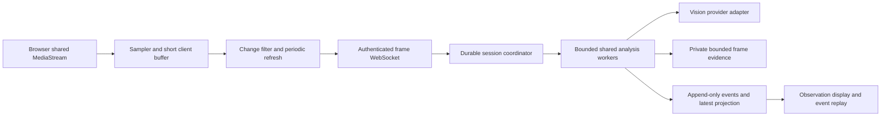

# Minimum viable prototype: screen capture and continuous observation

Date: 13 October 2026 · Status: broader build design; initial capture receiver implemented locally

Implementation update: native screen sharing and the initial [FastAPI capture receiver](../../prototypes/screen_capture/README.md) are implemented. A separate [private hosted adapter](https://kiki-screen-receiver.woodsycarp256.chatgpt.site) provides browser access and now adds bounded selected-frame Gemini analysis; see [decision 0003](../decisions/0003-selected-frame-analysis.md) and [active results](../plans/active.md). The hosted transport is binary HTTPS POST, local FastAPI transport is WebSocket; neither is a WebRTC media receiver. The actual trial uses at most 0.5 Hz capture, independent analysis starts at least 10 seconds apart, 30 analysis starts per normal UI session, and no receiver image archive. Source-frame provenance and current JSON are implemented; durable hosted history, retained input pixels, adaptive selection and distributed lifecycle/budgets below remain proposals. The remaining sections preserve the broader design rather than claiming it is all built.

## Outcome and recommendation

The student starts browser screen/tab sharing. Kiki repeatedly analyzes selected frames and exposes a JSON `observation` containing visible state, changes, uncertainty and frame-level evidence. An append-only event history starts with capture_started and records interruptions, rejected/failed analyses and observation updates. The latest observation is a derived projection of that history.

Recommend **sampled images over WebSocket for the first prototype**, with a transport-independent FrameEnvelope. Use 0.5 Hz as the candidate sampling baseline, adaptive selection and a forced refresh, plus bounded evidence retention. Keep WebRTC available as a later transport/temporal experiment. This recommendation is not a user-confirmed production decision.

The key distinction is between capture cadence, model analysis cadence and retention policy. A browser can receive a continuous video MediaStream while extracting selected images; neither that stream nor every sampled image must be archived in cloud storage. Screen sharing, transmitting video and recording video are separate operations.

At 0.5 Hz the system samples one frame every two seconds. This is a sparse state sequence. A short dialog, drag path, click or intermediate parameter value can appear and disappear between frames. It cannot support a claim of video continuity or exhaustive action tracking.

## Source, scope and known state

Use [screen-awareness plan](../plans/screen-awareness-mvp.md), [graphics/annotation handoff](../handoffs/graphics-and-annotation.md), [FastAPI worker design](mixed-language-fastapi.md), [confirmed student journey](../../context/design-thinking/docs/ux/student-journey-odia-ece.md) and [prototype directions](../../context/design-thinking/docs/prototypes/backend-prototype-directions.md).

The current user selected screen/tab sharing and JSON observations with provenance, then asked for API design and this document. FastAPI and a logical worker/actor hierarchy are existing choices. The later authorized trial proved structured Gemini output on two controlled images. A durable hosted store/queue, WebRTC media receiver, actual Simulink evaluation and overlay remain unproven. BB8 coordinator and engineering-architecture are applied in reference mode.

In scope for the future MVP: one desktop browser, one shared surface, a visible start/pause/stop interface, capture and frame selection, one model adapter, bounded session processing, current JSON and replayable events, evidence retention and measurements. Fixture and live modes must be labeled.

Subsequent scope: instructional next steps, actual tool overlays, generated teaching scenes and synchronized narration. Full-session recording, audio capture, autonomous clicks/wiring/running, broad backend scaffolding and deployment are outside the first observation slice. The student continues to perform lab actions. Writing this design does not start those builds or authorize external provider trials.

## Transport decision

| Option | What crosses the network | Benefits | Costs and limits | Choose when |
| --- | --- | --- | --- | --- |
| Sampled images over WebSocket | Binary JPEG/WebP frames plus metadata | Direct frame identities, bounded admission, simple structured-output adapter and replay | Independent images repeat visual information; sparse sampling misses motion and brief transitions | First milestone is recognizing visible current state |
| WebRTC media stream | Encoded video packets; server decodes/selects frames | Temporal material, efficient inter-frame compression on some screens, media congestion handling | Signaling, ICE/TURN, receiver/codec/decoder operations; actual bitrate varies | Motion/action order or continuous video ingestion has measurable value |
| WebRTC plus selective evidence | Live video, chosen retained frames/clips | Temporal access without a mandatory full-video archive | Both media infrastructure and evidence selection; more lifecycle cases | Video trial proves meaningful improvement |
| HTTP frame uploads | Independent image requests | Straightforward occasional screenshots or transport fallback | More request overhead; observations still need polling or events | Low-frequency/manual capture or WebSocket restrictions |

WebRTC does not prescribe model cadence, storage or recording. A server receiving video but analyzing only every two seconds still misses intermediate actions in its observations. Temporal understanding needs multiple temporal inputs and an adapter/model demonstrated to use them; merely changing transport is insufficient.

getDisplayMedia() acquires the selected surface after a user gesture and native chooser in a supported secure browser context. Read the actual video track settings where available. Do not claim knowledge of the shared page URL, DOM, offscreen state or exact workspace identity from those settings alone. Browser sharing exposes pixels; tool-specific semantic IDs require another integration.

Screen observation and overlay access have different acceptance gates. Sharing pixels does not grant permission or technical ability to draw inside Simulink's origin. A future supported extension/tool adapter remains a separate investigation.

## Architecture and ownership



FastAPI owns session authorization, configuration, REST/WebSocket contracts and event access. A durable per-session coordinator serializes state/epoch transitions, admission, cancellation and publication. Shared workers perform image checks, provider calls and validation; a worker is not one process or model instance per session. Global provider concurrency and usage ceilings apply across sessions.

The browser owns capture, local buffering and sampling. The model owns evidence-backed visual interpretation. Runtime code owns timestamps, hashes, identities, budgets, event ordering and projection updates. No model-generated timestamp or arbitrary confidence number establishes provenance.

Recommended local MVP persistence is SQLite on durable local disk with one API instance and bounded workers; select it explicitly before implementing. It supports fixture replay without provisioning cloud services. A local filesystem evidence adapter mirrors future object storage. This is a prototype recommendation, not adoption of a production store. Multiple API replicas require a shared authoritative store/lease mechanism and a validated queue strategy; SQLite files must not be treated as a distributed database.

## Sampling, analysis and freshness

Proposed tunable starting settings:

| Setting | Initial proposal | Rationale |
| --- | --- | --- |
| Candidate sampling | Every 2 seconds, including an immediate first frame | Evaluate the user's 0.5 Hz idea |
| Frame dimensions | Preserve aspect ratio; target maximum dimension 1600 px | Starting bandwidth bound; validate small parameter text before reducing resolution |
| Encoding | JPEG or WebP; maximum transmitted frame 1 MB | Binary payloads; quality is set by legibility, not a promised 100 KB size |
| Change selection | Tile-sensitive visual differences | Small parameter edits should not disappear in a whole-screen average |
| Forced refresh | At least an admission opportunity every 10 seconds | Protect against false negatives and drift; capacity failures remain explicit |
| Analysis ceiling | At most one admitted analysis every 2 seconds/session | Independent from candidate capture |
| In-flight work | One running analysis and one replaceable pending candidate/session | Prevent an old-screen queue |
| Local ring | Up to 20 seconds, capped at 20 MB | Recent context without a cloud archive; no persistent browser recording |
| Freshness threshold | Mark last model observation stale after 10 seconds | A provisional UI policy to measure and tune |
| Session limit | 30 minutes initially | Bounded feasibility trial |

Start with fixed 0.5 Hz as the measurable baseline, then compare change filtering at that same candidate cadence. A later higher-rate local detector can collect brief transitions while analysis stays bounded. Do not assume access to click/scroll events inside the shared foreign tab; observe its pixels or use a separately supported integration.

Send a changed frame when admission allows; on unchanged screens, send a forced refresh. Use a bounded preceding frame when comparing changes. Never resend the entire recording or unlimited event history. Compose context from the current observation, a bounded checkpoint summary and referenced previous events/frames. Track context hashes and references; a summary remains derived interpretation and may contain earlier mistakes.

Separate capture heartbeats from visual confirmations. A browser heartbeat only means capture is running. An unchanged detector result is not a new model analysis. Display last analyzed capture time, newest captured time and model-observation age separately. At healthy fixed 0.5 Hz, a persistent change may wait nearly 2 seconds for sampling, then inference and publication time. A below-threshold change can wait until forced refresh; there is no guaranteed freshness while capacity is degraded.

Replace an obsolete pending candidate, recording a coalesced sequence range. Keep enough admission metadata to identify coverage gaps without archiving every image. Reject stale completion by epoch and fenced attempt generation; use capture order for latest-state eligibility. On source change or stop, older work may enter the audit log as discarded but cannot become the current observation.

## API and session lifecycle

| API | Contract |
| --- | --- |
| POST /screen-sessions | Authenticate; create awaiting_share session; return negotiated budgets, schema version and relative stream URL |
| WS /screen-sessions/{id}/stream | Client sends capture lifecycle, frame envelopes and binary image payloads; server emits acknowledgments, observations, status and budget events |
| GET /screen-sessions/{id}/observation | Return latest projection and dynamically computed freshness, or observation=null with awaiting_first_observation |
| GET /screen-sessions/{id}/events?after={cursor}&limit={n} | Return ordered bounded event pages and next cursor; recover history after connection loss |
| POST /screen-sessions/{id}/pause | Pause analysis/capture according to explicit mode; record lifecycle event |
| POST /screen-sessions/{id}/resume | Revalidate active surface and lease; request a fresh frame; no fabricated coverage of pause |
| POST /screen-sessions/{id}/stop | Idempotently end capture/analysis admission; invalidate in-flight publication rights |

Example create request:

```json
{
  "transport": "frames_ws",
  "capture_candidate_hz": 0.5,
  "retention_mode": "selected_evidence",
  "session_limit_seconds": 1800
}
```

The server returns its applied configuration; requested settings never override server caps. Scope creation idempotency keys to the owner. Authorize every read/write and WebSocket handshake; browser-compatible session authentication must include origin checks where cookies are used. Keep provider credentials on the server. Transport authentication is separate from native capture permission.

Use an ordered metadata-message/binary-message pair on the single producer connection with frame_id and declared byte count. Bound incomplete pairs, check decoded dimensions and actual byte count, and verify encoded-byte hash server-side. Base64 in a JSON frame increases payload size and is not the preferred transfer format. ACK distinguishes received, queued, coalesced, rejected and analyzed; a transport receipt alone is not successful analysis. Idempotency is (session, capture_epoch, frame_sequence) with matching payload hash; conflicting duplicates fail.

For WebRTC later: POST /screen-sessions/{id}/webrtc/offer exchanges SDP; authenticated signaling exchanges ICE candidates or uses complete non-trickle descriptions. The negotiated media connection carries video. FastAPI signaling needs an actual media receiver such as an evaluated aiortc integration or dedicated media service, plus connectivity testing and TURN when required. WebRTC decoding must emit the same FrameEnvelope and mapped session-relative timestamps. Do not assume direct video ingestion is supported by the vision provider.

Lifecycle: awaiting_share -> sharing -> paused/disconnected/degraded -> sharing, then ended/expired. Track analysis state separately: awaiting_first, pending, available, stale or failed. Share chooser cancellation/denial leaves no invented first frame. Track ended/mute, network loss, pause and explicit stop create events. Reconnection records a gap and obtains a fresh frame. Source replacement increments capture_epoch and resets the surface-state projection; a single producer lease/version prevents competing devices. A restart rebuilds durable state and requires fresh capture before marking awareness current.

The isolated capture trial starts after explicit sharing. Later guided labs preserve experiment selection, required concept checks at 60%, correct workspace and confirmed observation connection; the 80% chapter test is a different gate.

## Data and provenance

FrameEnvelope fields: session_id, capture_epoch, source identifier scoped to the session, monotonic frame_sequence, frame_id, captured_elapsed_ms, server_received_at, source/capture dimensions, MIME type, encoding/resize transform, byte count and server-verified SHA-256. Store the mapping between wall-clock session start and monotonic client capture time; client timestamps are reported capture times, not trusted server time. Source geometry changes get a new geometry revision even without a new source epoch.

AnalysisAttempt fields: attempt_id and generation, input frame IDs/hashes, prior event/summary references, model/provider and prompt/schema versions, input context hash, started/completed server time, outcome, latency and provider usage when supplied. Durably record attempts before calls; a crash may leave an unknown provider outcome. Use bounded classified retries within session budget, not blind repetition.

ObservationEvent fields: event_id, server-assigned event_sequence, previous event, epoch, attempt reference, observed capture range, published server time, visible facts, changes, interpretations, uncertainties and evidence IDs. Every visual finding references a frame and, where useful, normalized [x,y,width,height] in that encoded frame. A visual label supports a hypothesis about the tool; it does not authenticate a workspace identity. Cross-frame entity identity is provisional unless a tool adapter supplies a stable ID.

Facts keep first_seen and last_confirmed references. Absence from the viewport means not_visible, not deleted. Corrected claims reference the superseded claim/event; history remains intact. Hidden values, offscreen wires or causation between two sampled states must remain unknown/inferred unless evidence supports them. Screens are task data, including any embedded text that looks like an instruction.

Illustrative latest projection, not actual captured evidence:

```json
{
  "schema": "screen-awareness/v1",
  "session_id": "session-001",
  "capture_epoch": 1,
  "capture_status": "sharing",
  "observation": {
    "revision": 7,
    "event_id": "obs-007",
    "observed_elapsed_ms": 8400,
    "published_elapsed_ms": 9200,
    "analysis_status": "available",
    "summary": "A model canvas is visible with a selected source block.",
    "facts": [{
      "id": "fact-003",
      "description": "The selected block displays the label Message.",
      "basis": "visible_text",
      "evidence": [{
        "frame_id": "frame-017",
        "region_normalized": [0.12, 0.24, 0.2, 0.1]
      }],
      "first_seen_event": "obs-004",
      "last_confirmed_event": "obs-007"
    }],
    "changes": [{
      "description": "The Message block now appears selected.",
      "compared_with_event": "obs-006",
      "evidence_frame_ids": ["frame-015", "frame-017"]
    }],
    "uncertainties": ["The block parameter values are not visible."],
    "provenance": {
      "attempt_id": "attempt-007",
      "previous_event_id": "obs-006",
      "input_frame_ids": ["frame-015", "frame-017"],
      "context_event_ids": ["obs-006"],
      "model": "configured-vision-model",
      "prompt_version": "screen-observer/v1"
    }
  },
  "freshness": {
    "latest_captured_elapsed_ms": 9100,
    "last_analyzed_capture_elapsed_ms": 8400,
    "computed_at_elapsed_ms": 9300,
    "age_ms": 900,
    "stale": false
  },
  "history": {
    "event_log_ref": "session-001/observations",
    "frame_manifest_ref": "session-001/frames",
    "coverage": "sampled_frames",
    "gaps": []
  }
}
```

Validate schema, frame ownership/epoch, bounding regions and reference existence before publishing. Structural validity does not prove visual correctness; labeled reviewer evaluation remains separate. Persist an event and its projection transactionally before broadcasting. Append-only history is bounded by declared retention: after history expiry, return explicit expired-history status rather than pretending a complete replay still exists.

## Storage and cost controls

Retain chronological event metadata from capture start. Keep raw inputs for admitted analyses, including a bounded selected failure/rejection sample, within an explicit retention window. The default does not upload all candidate frames or preserve a full video. Do not persist provider inputs in general-purpose application logs.

Proposed policy: client frames live at most 20 seconds/20 MB; session raw evidence at most 100 MB for a 30-minute trial; raw evidence expires no later than 24 hours; JSON history expires after 7 days. Required input frames are saved before the provider call and published claim. If raw-evidence capacity is exhausted, pause new analysis and emit budget_exhausted; keep capture/status visible. A user-requested lower cap likewise changes admission. Never silently delete required evidence to keep publishing apparently auditable observations.

Record each evidence item's captured time, byte hash, object reference, expires_at and lifecycle state (retained/expired/deleted). Expiry invalidates replayable pixels but leaves their metadata until event-history expiry. A hash identifies bytes; it cannot reconstruct them or independently prove the visual finding after deletion. Provide an explicit bounded export option later if long-term image audit is required.

Optimization order:

1. Filter candidate frames before network transmission; force periodic refresh and measure missed small changes.
2. Enforce legibility-aware image size and encoding; avoid PNG defaults for every photographic/window frame and avoid base64 payload expansion.
3. Keep only frames actually used by analyses and a bounded failure sample. One source frame can serve multiple evidence references.
4. Deduplicate exact byte-identical images within the owner's session. Perceptual similarity can select candidates but cannot substitute one evidence image for a different one. New capture occurrences keep their timestamps and point to the shared exact image object.
5. Expire evidence and enforce byte/session ceilings. Persist compact event deltas with periodic reconstructible checkpoints rather than duplicating an expanding full history in every snapshot.
6. If measured object-operation overhead warrants it, batch retained images into immutable packs (for example up to 60 seconds or 5 MB, whichever first). Address each by object key, member name, pack hash and individual image hash. Member encoding stays independently readable. Keep the unflushed tail on bounded durable staging storage; mark its staging/committed state accurately. Pack TTL follows its retention requirements.
7. Add video/clips only if replay or temporal understanding justifies their bandwidth, decode and retention costs.

Packing reduces object operations, not underlying image bytes. Video inter-frame compression can be smaller than independent images on stable screens; faster video can also be much larger. Measure the actual content, codec and bitrate rather than choosing either based on a general storage claim.

All following arithmetic uses decimal KB/MB/GB and illustrative sizes/bitrates, not observed costs:

| Mode | Per 30 minutes | Per hour |
| --- | --- | --- |
| 0.5 Hz, all candidates | 900 frames | 1,800 frames |
| Images averaging 50 KB | 45 MB | 90 MB |
| Images averaging 100 KB | 90 MB | 180 MB |
| Images averaging 200 KB | 180 MB | 360 MB |
| Video averaging 0.2 Mbit/s | 45 MB | 90 MB |
| Video averaging 1 Mbit/s | 225 MB | 450 MB |
| Video averaging 2 Mbit/s | 450 MB | 900 MB |

Formula: frames = candidate_hz * seconds; image bytes = retained_frames * mean_encoded_bytes; video bytes = mean_bits_per_second * seconds / 8. At 0.5 Hz, 100 KB/frame is equivalent to 0.4 Mbit/s of image payload before transport overhead. A measured video bitrate below that could use less bandwidth for continuous media; it still brings decoder and transport costs.

100 simultaneous continuously changing sessions at 100 KB/frame produce up to 18 GB/hour if all candidates are retained, 180,000 image-object writes/hour if stored individually, and up to 50 analysis requests/second at 0.5 Hz. The last figure may be the harder cost/quota constraint. Fixed sampling is not a license to issue every possible call.

For a purely illustrative retained fraction r=0.1, image bytes would be 18 MB/hour/session. This is a sensitivity calculation, not a promised compression/selection result. Log actual candidate, selected, admitted, analyzed, coalesced, retained and expired counts independently. If event payloads averaged 2 KB at 1,800 events/hour, their payload alone would be 3.6 MB/hour, excluding database indexes and replication. Measure JSON growth too.

Total cost includes model requests/tokens, frame upload/egress, storage byte-hours, storage operations, worker CPU/decode, database operations and any TURN relay traffic. No provider-specific price is asserted here.

## Build sequence and acceptance

Follow [Now / Next / Later](../plans/screen-awareness-mvp.md). First write runtime schemas and implement one fixture capture-to-observation slice. Next add durable recovery/retention and one evaluated live model. Keep the codebase bounded: capture client, session API/coordinator, vision adapter, event store and evidence store. Module directories and dependencies are implementation choices; do not create service layers merely because this document names responsibilities.

Acceptance cases for the future build:

| Scenario | Required evidence |
| --- | --- |
| Share starts/stops or chooser is cancelled | Native capture state matches JSON lifecycle; first/last event and no fabricated frame |
| Persistent known state | Correct visible facts with actual frame/region references; hidden fields remain unknown |
| Small parameter edit | Changed digits preserved by encode and detected by selection/analysis; reviewer checks values |
| Brief dialog or drag | Mark whether observed or missed; sampled mode never invents intermediate motion/action order |
| Unchanged screen | Candidate count continues; model calls/retained bytes reduce; periodic refresh and freshness stay honest |
| Slow provider or quota failure | Bounded memory/queue; old candidates coalesce; status degrades; session/global budgets hold |
| Duplicate, malformed or oversized frame | Reject or deduplicate predictably without duplicate analysis/event publication |
| Surface switch and late model result | Epoch changes; old result cannot overwrite current observation |
| Disconnect/restart/reconnect | Ordered history recoverable; missing interval explicit; fresh capture required |
| Evidence expiry/budget exhaustion | Pixels unavailable status and expiry visible; new analysis pauses before exceeding cap |
| Unauthorized session/capture access | Ownership enforced for REST, WebSocket, events and evidence reads |

Use the same scripted task set for fixed images, adaptive images and any video trial: block selection, small value edit, dialog open/close, canvas movement, dragging and an unchanged interval. Label persistent-state recognition separately from transient-action recognition. Suggested first benchmark: 12 reviewer-labeled persistent states held at least 6 seconds, plus a separate set of brief transitions. Report actual counts and errors; do not advertise a generalized accuracy percentage from this small set.

Provisional engineering goals: no unsupported critical parameter claim on the labeled set, all published visual findings resolve to retained inputs during their TTL, exact chronology under lifecycle faults, and healthy p95 published-observation age at most 6 seconds. These are targets to validate, not achieved results. A stale marker must remain correct when the latency target fails. Test 30-minute capacity and restart behavior before longer sessions.

## Connection to next steps and graphics

The observation feeds a later bounded planner using the selected experiment, procedure and checkpoint evidence. A proposed step contains instruction, reason, semantic target, visual cue intent, completion predicate and observation/epoch validity. A drawing cue is not proof of action or learning. Wait for the student's action and reobserve before advancing.

Use a restricted semantic graphics/annotation spec and deterministic SVG/Canvas renderer for pointers, halos, arrows, boxes, ghost paths and text. Share primitives while keeping three target modes: generated scenes use versioned object IDs; uploaded pages use original coordinates with transforms; live screens use fresh anchors and expiry. Low-confidence or stale live targets pause cues. Overlays remain pointer-transparent and do not replace the student's cursor.

Candidate teaching scene: control input -> VCO -> output, tied to the existing ideal equation and reviewed values. Preserve an editable scene, poster and GIF export; raster illustration can support a precise semantic layer. Scientific review, current green-concept/red-terms/yellow-English/blue-practical semantics, accessible labels, phone readability and reduced motion remain requirements. English SVG labels have Odia explanations alongside them.

Teaching timelines use actual audio playback time and validated sentence/span mappings; current audio only has total duration. Pause/seek/rate/profile changes invalidate/update those tracks. Live guidance advances by checkpoints rather than a narration timer. Simulink observation access and real overlay geometry must be tested separately from the controlled-page graphics demonstration.

## Decisions to record after the prototype

Choose image-first or video based on temporal failures, latency and measured cost. Confirm whether full-session replay is actually required. Set retention and budget policy from measured evidence sizes and intended audit lifetime. Select the provider and production store/queue only after capability/access and recovery checks. Expand to instructional cues when screen evidence is dependable.

Last completed action for this design phase: produced this scoped build document and its plan. No implementation or live screen/provider result is claimed. Exact next action is the runtime-schema and fixture sampler/API slice when implementation is requested.
