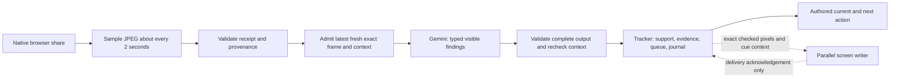

# Screen-reader baseline v1 — end-to-end record

Frozen 14 October 2026. Status: working private hosted prototype; latency experiments paused.

## Outcome and evidence

The prototype lets a learner share a Simulink Online tab/screen, continuously receive sampled frames, read the visible model, track authored lab actions and checkpoints, and display a clear current action followed by the next action. The learner performs the edits, runs and saves. The system updates its observation and provenance incrementally and advances eligible checkpoints automatically after enough admitted screen evidence.

The learner's report at this pause is: **at least eight steps completed; the guidance was intuitive and understandable.** This is a user-reported usability result. It is not an independently audited eight-checkpoint transcript, complete twelve-step acceptance, simulator verification or conceptual mastery. Earlier confusing instructions and the Carrier/Local carrier ambiguity led to the beginner procedure and observer improvements recorded below.

The current private Site uses a **Worker/D1 compatibility backend**. The Python/FastAPI capture, observation and progress implementation exists and passes local tests; no reachable Python origin has been connected to the Site. A successful Site deployment must not be described as a deployed FastAPI service. The mixed-language text/speech library is a separate working prototype with recorded real provider trials; its API consolidation follows this baseline freeze.

## Immutable references and portable files

[The manifest](screen-reader-v1.manifest.json) records source hashes, versions and deployment references without credentials or private lab data.

- Latest main used for this branch: `2f8eb62bb837fbf7a57f785fdfd9728f4f5e5fb6`.
- Hosted source: `4e1d0c3d132ff2778216e5d7e4d987d3e04d7145`, copied into [prototypes/hosted_screen_reader](../../prototypes/hosted_screen_reader/).
- Deployed baseline: `appgdep_6acfbfc061748191a91d1bfa86bc5734`, successful at `2026-10-14T17:45:47.564774+00:00`, environment revision 6. The multi-key secret was saved in the Site runtime; its values/count are not inferred from redacted configuration.
- Python screen/lab source was captured from the authorized working tree; its hashes establish the actual files rather than pretending the old root HEAD already contained them.
- Lab observer: `dsb-step-observer/v3`; wire format: `lab-observer-json/v3`; default model: `gemini-3.5-flash-lite`.
- Policy: `screen-guided-policy/v2`; procedure: `dsb-beginner-procedure/v1`; screen-writing interface: `screen-writing/v0.2`.
- Scientific definition: [dsb-sc.demo-definition.json](../architecture/examples/dsb-sc.demo-definition.json), canonical hash `5ca32d343a4fb4e849c42ac8cb14702650ead4e2e2617a950fa038472f2f1543`.

The hosted copy deliberately excludes its original hosting project manifest. It cannot accidentally target the private baseline Site. Its historical README describes older stages; this document and the later decision documents state the frozen behavior. Experiments must provision a separate test surface when deployment is authorized.

## What was built, in order of capability

| Capability | Result and changes |
| --- | --- |
| Capture and receipt | Native browser tab/window/screen picker, sampled JPEG transport, returned server image, receipt JSON, sequence/hash/dimension provenance and lifecycle controls. Recoverable upload throttling no longer ends the share. |
| Frame analysis | Server-side Gemini key, exact admitted pixels, visible summary and typed findings, latest-frame selection, no backlog of old analysis work. |
| Focused lab | Source analysis of the two referenced analog-modulation JSONs; one DSB-SC/coherent-recovery builder trial; twelve authored checkpoints, now/next queue, visits, evidence and student responses. |
| Python backend | FastAPI contracts, capture WebSocket, asynchronous analysis, durable SQLite progress/journal, owner isolation, freshness/context fences and ephemeral checked-frame handles. A Site proxy is prepared but inactive. |
| Screen-writing handoff | Breaking v0.2 cue request/target resolution/packet/cancellation/ACK contract and synthetic reference checks; ownership remains split. Actual Simulink overlay is a separate integration test. |
| Automatic tracking | Learner selected automatic advancement when pixels provide enough evidence; two distinct admitted matching frames; explicit saves/reports where pixels cannot establish the action. Progress stays unassessed. |
| Beginner guidance | Replaced the hard-to-follow checklist with one current action, suggested placement, concrete procedure, inline values, expected result and next action. Forty ordered actions distinguish construction, settings and connections. |
| Continuous operation | Removed artificial run/read/event counters; capture and progress survive provider waits; newest fresh frame is checked after cooldown. Finite infrastructure/quota constraints still apply. |
| Provider recovery | Durable key rotation and cooldowns, 503/transport fallback, shared-project 429 handling, safe model comparison, server-only secrets. |
| Latency slice | Three-second active admission floor; twelve-second idle cadence; stable supported frames skipped; redundant hosted refresh removed; timing metadata added. Original observer prompt/full-ID JSON retained. |

## Capture → observation → progress → guidance

1. **Native capture.** `getDisplayMedia` reads real shared pixels; the user grants and stops sharing. The current prototype samples approximately 0.5 Hz. It does not send continuous video over WebRTC. The hosted path uploads HTTP JPEGs; the Python path sends validated JPEG envelopes/binary messages over a WebSocket. A client keeps at most one upload in flight.
2. **Receipt.** Frames are JPEG, at most 1 MB, maximum encoded dimension 1600 px. Ordering and dimensions are validated; runtime calculates SHA-256. Metadata includes frame/sequence, capture segment, view revision, encoded/source dimensions, capture-relative time and server receipt time. Receipt acknowledgement means received, not understood.
3. **Admission.** The server retrieves/verifies exact admitted pixels and freezes owner/session, checkpoint, visit, workspace, capture epoch, view revision, parameter revision and experiment condition. Frame age is at most six seconds at admission. A newer received frame never rewrites an already admitted input.
4. **Recognition.** The model receives the screenshot, selected model, authored scientific criteria and ordered procedure. It returns a visible summary and exactly identified criterion/action findings: `match`, `mismatch` or `unknown`, with supporting text. Hidden/unreadable objects are unknown. Screenshot text and student reports are untrusted data. The model describes; it does not author the next procedure or award understanding.
5. **Acceptance.** Validate complete JSON, known unique IDs, statuses, required findings/evidence and provider `STOP` termination. Recheck lifecycle, age and frozen context after inference. Stale visits/views/conditions/parameters and foreign provenance are discarded. Analysis/review pixels must remain within twenty seconds of receipt.
The v3 prompt requests every action finding. The frozen validator retains an empty-action-list compatibility path for older reviewed-mode fixtures; when action findings are present, it checks their exact unique authored set. Do not describe that compatibility path as strict enforcement of all v3 actions. Streaming experiments must explicitly test and require the complete intended finding set.

6. **Tracking.** Eligible visible items need two matching observations from distinct admitted frame IDs, with recent support no older than 120 seconds. Mismatches invalidate relevant support. Historical action progress survives hidden views/pauses and helps avoid recreating blocks; it cannot substitute for fresh checkpoint evidence. All checkpoint subcriteria must be satisfied before advancement.
7. **Guidance.** Python-authored procedure owns `current_action`, `next_action`, placement, how-to, settings and expected result. The model's summary reports the present view separately from remembered progress. Current/next move within a checkpoint before advancing to the next checkpoint. Saving, prediction, observation and explanation use explicit unassessed reports/confirmations when required.
8. **Persistence.** A revision-fenced projection and append-only journal preserve visits, criteria, action history, typed responses, failure/correction events and neutral timing. Revisit makes a new visit and resets appropriate downstream current progress while preserving prior evidence. Pauses/gaps are recorded rather than counted as continuous observation.
9. **Writing boundary.** The tracker can provide the exact checked JPEG via an owned ephemeral handle and trusted context. Handle expiry is no later than eight seconds after analysis completion or twenty seconds after receipt. Resolution/rendering/transform/cancellation/delivery ACKs belong to the parallel writer. Rendering never completes a checkpoint. A real screen read and a real overlay are separate acceptance outcomes.

## Focused experiment and full step ledger

The selected experiment is `PR-AM-DSB`: build DSB-SC modulation and coherent recovery, compare the recovered message, introduce one relative phase fault, then restore baseline. The source JSONs are pinned to Design-Thinking commit `2a6c843448d81062f89596b941516f8b7817ec79`: `data-model/ledgers/electronics/analog-modulation.json` and `data-model/cases/analog-modulation-odia.json`. The broader imported product snapshot remains separately pinned and unchanged.

| Checkpoint | Ordered beginner work | Actions |
| --- | --- | ---: |
| CP-DSB-01 | Open a blank selected workspace; save with the entered name. | 2 |
| CP-DSB-02 | Place/rename Message, then Carrier Sine Wave sources. | 2 |
| CP-DSB-03 | Configure Message at 100 Hz, then Carrier at 2000 Hz. | 2 |
| CP-DSB-04 | Place/rename Modulator Product; wire Message and Carrier to its two inputs. | 3 |
| CP-DSB-05 | Create **a separate third source, Local carrier**; configure it; create Receiver product; connect Modulator output and Local carrier. | 5 |
| CP-DSB-06 | Create/configure Lowpass Transfer Fcn and Recovery gain; connect receiver → filter → gain. | 5 |
| CP-DSB-07 | Create/configure scopes and branch the input/modulated/recovery comparison connections. | 4 |
| CP-DSB-08 | Set stop time, solver and maximum step. | 3 |
| CP-DSB-09 | Run the baseline and establish completion/no visible error. | 1 |
| CP-DSB-10 | Show recovery comparison; compare original/recovered; record the learner's observation. | 3 |
| CP-DSB-11 | Predict, shift Local carrier phase, run, inspect result and report the phase-fault observation. | 5 |
| CP-DSB-12 | Restore Local carrier phase, run, compare recovery, save and explain carrier alignment. | 5 |

Exact block values, connections, filter arrays and criteria are in the definition. Exact action placement/how-to/copy is in [procedure.py](../../prototypes/lab_tracking/procedure.py). Suggested placement is instructional text, not a resolved pixel location.

Message: amplitude 1, bias 0, frequency `2*pi*100`, phase 0, sample time 0. Carrier and Local carrier: amplitude 1, bias 0, frequency `2*pi*2000`, phase `pi/2`, sample time 0. All use time-based simulation time. Carrier is the transmitter source; identical numbers do not establish Local carrier identity. Lowpass uses the authored 500 Hz coefficient arrays; gain is 2. Stop time is 0.1 s, solver `ode45`, maximum step `1e-5` s. The chosen fault changes Local carrier phase from `pi/2` to `pi`, then restores `pi/2`; frequency/filter faults remain outside this demo run.

## Provenance, student state and retention

The projection separates current observation, queue/step state, historical evidence, learner responses and learner-state dimensions. Concept, terminology, English and practical evidence are distinct. Screen-inferred progress is labelled; understanding/prerequisite readiness remains unknown/unassessed unless separately assessed. A slow step, repeated settings edits, help requests or pauses are useful telemetry, not diagnoses of confusion or proficiency.

Capture time is client-monotonic elapsed time. Receipt/admission/completion are server UTC; provider durations use monotonic clocks. No clock calibration establishing true cross-device capture-to-display delay is implemented. Geometry `view_revision` currently detects dimension changes and explicit view-change reports; generic sharing does not detect every pan, scroll, zoom or modal event.

Python keeps latest received/checked raw pixels in memory. The hosted lab retains its latest checked JPEG in D1 until replacement/deletion/processed invalidation; an expired handle cannot retrieve it, but handle expiry is not a proven physical storage TTL. There is no video or historical screenshot archive. Metadata/journal persist until deletion; no automatic metadata TTL is claimed. `events?after=&limit=` paginates; last 100 responses are a projection/prompt window rather than a history rejection cap. Neither hashes nor the journal reconstruct absent historical pixels.

## Provider settings and failure behavior

Credentials stay server-side. `GEMINI_API_KEYS` is a JSON list of strings or `{key, quota_pool}` entries, up to sixteen distinct nonempty keys; malformed/duplicate configuration fails closed. It supersedes `GEMINI_API_KEY` when supplied. Two or more distinct keys are needed to avoid consecutive reuse; the single-key fallback cannot alternate.

The durable rotation cursor/lease and failed sweep survive restarts. 503/network failures move to the next eligible key within the twenty-second frame budget; a multi-key attempt is bounded to eight seconds. A completely failed/unavailable sweep waits at least sixty seconds, or longer `Retry-After`. Successful cycles do not impose a minute of artificial waiting. A 429 blocks sibling keys in the same actual project/model quota pool; adding keys to one project does not increase its RPM/TPM. Quota labels are administrator declarations, not independently verified project identity. Configuration/auth failures have longer spacing; there is no automatic different-model/provider fallback.

Capture and durable progress continue while analysis waits. Fresh latest pixels are used after cooldown; no old-frame backlog is replayed. `Analysis off` in the generic observation card can mean generic analysis was disabled because lab guidance owns the analyzer; it is not sufficient evidence that lab analysis is disabled. See the [rotation guide](../decisions/key-rotation-and-model-comparison.md) and [continuous-operation decision](../decisions/continuous-screen-analysis.md).

## Measured latency and rejected alternatives

The last inspected production sample contained thirteen successful check invocations, covering **23:38:28–23:40:56 IST on 14 October** (`18:08:28–18:10:56 UTC`). Logs were capped; this is a sample, not the complete requested window or an SLA.

| Measure | Value | Meaning |
| --- | ---: | --- |
| Check request HTTP wall time, median / min / max | 9.599 / 8.197 / 10.502 s | Thirteen HTTP 200 invocations; includes work beyond the internal timer. |
| Latest retained successful provider time | 6.847 s | Includes key routing/storage plus Gemini HTTP; not isolated inference. |
| Latest retained internal check time | 7.516 s | Associated with one retained successful checked frame. |
| Latest retained received-frame-to-result time | 7.998 s | Receipt-to-result, not calibrated capture-to-user-display. |
| Latest retained output | 323 tokens | Provider usage metadata, separate from findings. |

No provider failure log appeared in that retained sample. This does not establish a failure-free entire session. The retained successful timing is not a new success timestamp when the current candidate has been cleared by capture lifecycle changes.

The cadence optimization is already part of this baseline: 3 s active starts, 12 s idle checks, stable-supported skipping, provider deadlines and one-check-in-flight guards. It preserves two distinct matches, freshness and current context. Faster cadence can consume more quota.

Two earlier compact-output trials were rejected. Full-ID v3 JSON passed four focused controlled cases; compact positional output failed three, and compact stable-ID output still incorrectly matched hidden wires. The small paired trials did not show a reliable latency gain (baseline median about 4.11 s; compact-ID about 5.32 s). Model/format changes, cache/order, stochastic output and provider load confound these single-call timings. **TOON was not tested; no JSON/TOON streaming endpoint exists yet.** Safe historical reports are in the hosted snapshot's `docs/evidence/`; four labelled synthetic screenshots are now committed under [fixtures/screen-reader-baseline](../../fixtures/screen-reader-baseline/).

## Checks and operating boundaries

At the pre-freeze code state: 87 Python tests and 51 Worker tests passed; v0.2 screen-writing reference acceptance had 39 synthetic cases; source integrity and BB8 checks passed. The fresh branch's actual recheck and API-consolidation results are recorded in [active.md](../plans/active.md). Mock/synthetic tests verify mechanisms, not broad Simulink visual accuracy. Earlier controlled native tab-sharing trials exercised receipt/lifecycle/guide behavior; the latest latency slice did not receive new browser QA because browser-control tooling was unavailable.

Still open: twelve-step real-tool end-to-end acceptance; scientific/native-language review; production auth and retention policy; reachable persistent Python hosting; clock calibration; complete view invalidation; anchor/transform/live overlay integration; shared cross-pipeline provider scheduling. Browser-local Gemma remains a deferred parallel idea. The baseline is a prototype milestone.

## Next / later

Next, consolidate the existing mixed-language text/speech libraries with screen/lab FastAPI routes and produce a frontend endpoint handoff, clearly labelled local vs hosted. Then prepare isolated JSON-streaming and TOON-streaming branches from the same baseline, with the [shared comparison protocol](../experiments/screen-reader-streaming-comparison.md). Preparation is not an executed trial or deployment. Keep the working Site unchanged during the pause.
