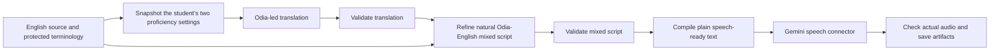

# Chosen English-to-mixed-language and audio pipeline

Date: 13 October 2026 · Status: accepted pipeline direction; backend implementation pending

## Decision and authority

The user accepted the listening prototype and requested that this be documented as the final pipeline for English-to-mixed-language translation and the audio connector. The same instruction selects **FastAPI** for the future backend, requires two tunable student proficiency numbers out of 10, and explicitly says **do not start building**. This records the chosen pipeline; it does not certify every prototype output or claim a production API exists.

The initial language pair is Odia–English. The source snapshot remains unchanged at `73d16c0d967a5d81dd74f1f28ef0defc48c8a778`. This decision takes precedence over older stack/default-provider suggestions in that snapshot.

The user subsequently endorsed a **worker/actor hierarchy for job management**. Adopt a logical admission/supervision boundary, a durable per-job coordinator and bounded stage-worker pools, with provider adapters underneath. Actor runtime, database and queue choices remain open. This is a software execution/state hierarchy; no LLM coordinator or separate service/process per actor is required. See the [actor design](../architecture/mixed-language-fastapi.md#worker-and-actor-hierarchy).

## Canonical flow

The refinement stage compares against the original English as well as the translation. Validation gates each dependent stage. A normal completed result includes both text stages; a translation alone is a labelled draft. Speech for an incomplete draft is an explicit listening experiment, as in the longer trial, rather than the default endpoint completion path.

Use native Odia script, English technical terms in Latin letters, and coherent clauses. Preserve facts, uncertainty, ideal-model qualifications, negation, equations, units, values, and stable sentence IDs. Visible formulas remain separate from reviewed spoken expansions. Keep source references, glossary/version, request hashes, prompt/policy versions and actual provider/model identity with the result.

## Student inputs

Every future generation request must snapshot **`odia_proficiency`** and **`english_proficiency`** independently. Proposed validation is finite numeric values in **0–10 inclusive**, allowing decimals; reject booleans, strings and out-of-range values rather than clamping them. The range/granularity are a contract proposal, not implemented validation.

These are student-provided settings, not tested proficiency, vocabulary membership, language percentages, or weights that must sum to 10. At English 5/Odia 7, aim for simple Odia scaffolding with familiar English technical/mechanism phrases. Allow English helping phrases when they improve comprehension; do not substitute words randomly or force obscure Odia technical vocabulary. Protected English terminology remains stable at every setting.

The two numbers condition a versioned vocabulary/phrasing policy in **both** text stages. They do not establish that a particular word is known. Preserve student control; do not change their saved ratings from playback telemetry or interpret listening as mastery. More detailed term preferences or demonstrated vocabulary may later improve precision without making a third field mandatory.

The current v2 prompt is a measured **5/7 experiment**, with VCO-specific s3/s4 instructions. Arbitrary scores and arbitrary source paragraphs still need a generalized prompt and representative evaluation. The shared CLI does not yet expose these two numbers.

## Audio connector

The proven listening path uses **`gemini-3.8-flash-lite-tts`**, **Kore**, and the Gemini **Interactions REST v1beta** API. Send the exact speech-ready transcript in the text field and narration delivery in separate `speech_metadata.style`. The current adapter also supports `gemini-3.8-flash-tts`, but its default is not evidence of a completed live trial with that model.

Keep the API key server-side in the process environment/header; inherit proxy/TLS trust. Decode the returned audio, check complete non-silent 24 kHz mono 16-bit WAV, and retain its actual duration/hash. The listening trial additionally made a 64 kbps MP3 with ffmpeg. Store separate script/audio readiness and pending pronunciation, native-Odia and spoken-fidelity review. The current audio manifest has **no sentence/word timing cues**.

Pacing can be instructed, but exact WPM is not established. See the [WPM assessment](../architecture/mixed-language-fastapi.md#wpm-and-playback-speed). Changing sample rate is not a speech-speed setting.

## Actual evidence and limits

| Evidence | Result and interpretation |
| --- | --- |
| Original four-sentence VCO, v2 profile | Both raw text stages passed automated checks with `gemini-3.5-flash-lite`; one intervening 503 was followed by a bounded resumed mixed call |
| Predeclared held-out paragraph | Both raw text stages passed with the same prompt/model; two cases do not establish a general compliance rate |
| Longer eight-sentence, 151-word input | `gemini-3.1-flash-lite` translation returned; display-preserving span-label repair was needed; three preferred-phrase warnings remain; final mixed refinement returned 503 |
| Four-sentence speech pilot | Actual 51.68-second recording using Flash Lite TTS/Kore |
| Longer draft speech | Actual 104.8-second recording; the user accepted its directional quality; formal scientific/native-Odia/pronunciation review remains unrecorded |
| Automated tests | 18 text tests and seven speech tests passed; these verify structural/preservation/adapter/media boundaries, not scientific or linguistic equivalence |

The negative-control experiment demonstrated that an unsupported scientific claim can pass the preservation validator. Human/domain evaluation remains separate. The accepted direction does not erase the longer trial's `mixed: null`, repairs or warnings.

Text models are server configuration, not a universal access guarantee. The validated 3.5 Flash Lite runs establish a text baseline, while 3.5/3.6 capacity failures and 3.1 output defects show why any fallback must be evaluated and recorded. Do not silently turn a fallback or partial draft into a completed result.

## Reuse and continuity

- Text implementation: [pipeline.py](../../prototypes/mixed_script/pipeline.py), [CLI](../../scripts/generate-mixed-script.py), [fixture](../../fixtures/mixed-script/vco.input.json).
- Prompt: [exact v2 copy](../../prototypes/mixed_script/prompts/learner-profile-v2.txt) and [evaluation notes](../../prototypes/mixed_script/prompts/README.md).
- Speech implementation: [speech.py](../../prototypes/mixed_script/speech.py); the text CLI and speech connector are currently separate.
- Original ignored results: `work/prompt-hardening/labels-v2-resume.result.json`, `work/prompt-hardening/heldout-v2.result.json`, `work/longer-vco-tts/bundle.draft.result.json`. The user-authorized [evidence archive](../../prototypes/mixed_script/evidence/2026-10-13/README.md) preserves their byte-identical copies, real recordings and trial history for another runtime.
- Owner-private listening page: https://kiki-vco-listening-draft.woodsycarp256.chatgpt.site . Its player source is a separate Site repository, not the backend service.
- Next design: [FastAPI architecture assessment](../architecture/mixed-language-fastapi.md). Parallel handoff: [graphics and annotation](../handoffs/graphics-and-annotation.md).

No FastAPI app, new runtime contract, generalized profile prompt or WPM control was implemented by this documentation decision. The user later explicitly authorized committing/pushing the session work; that publication does not authorize backend building.
