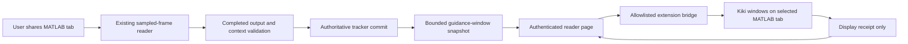

# Floating Kiki guidance windows — next-session handoff

17 October 2026, Asia/Kolkata. **Design and handoff only. No bubble implementation, extension release, model trial or Site deployment is authorized by this document.**

**Status, 18 October 2026:** the first slice was built on `experiment/floating-guidance-bubbles` and merged to `main` (PR #3, `6b14b5e`). kiki-web Lab mode now drives the windows ([kiki-web lab handoff](kiki-web-lab-mode-screen-share.md) §0). The branches named below were deleted after the merge. The documentation branch is kept as tag `archive/floating-design-notes` and the stopped annotation line as tag `archive/annotation-v22`; read references to those branches below as references to the tags.

## 1. User decision and outcome

The user stopped the annotation experiment:

> “stop all work on this annotation, what we will move towards is making the extension find the instructions for the next steps and the visible context into floating bubbles, I want you to understand how this can be facilitated and write a sizable handoff for the next session”

The subsequent clarification defines what “bubbles” means:

> “these bubbles are like little windows in our own design language that show what the site showed but on the same shared screen so that the user is able to see everything in one go”

The desired experience is **Kiki mini windows inside the shared Simulink Online tab**, showing the reader site's useful guidance and observation together with the actual simulator. The user should not need to alternate tabs to understand the current instruction, the next instruction, the relevant visible context and whether Kiki is connected or waiting.

This replaces the current experiment's product direction. Do not resume component highlighting, shapes, coordinate prediction, anchor resolution, ghost cursors, pixel-to-viewport transforms or annotation debugging. Preserve that work as a stopped reference. Concept explainers, scientific graphics and annotations on teaching images are separate workstreams; this decision does not authorize changes to them.

“Find the instructions” is interpreted here as **extract the authoritative structured instructions and accepted observation already produced by Kiki**, then display them in the extension. It does not mean a second model invocation, extension-side OCR, scraping arbitrary instructional text from MATLAB, or allowing the extension to choose the next lab action. This is a design interpretation, not an additional confirmed user requirement.

Success: while working in the real shared MATLAB tab, the user can read Kiki's current/next action and accepted visible context at once, keep instructions open long enough to follow them, move/minimize the windows, and distinguish saved instructions from fresh screen evidence. Window rendering never advances the lab.

## 2. Stop boundary and repository state

The documentation branch is `design/floating-guidance-bubbles`, created from `integration/analysis-owned-guidance` at `e93f99be4d2d4c64076116cbab74f8912483d135`. The parent records the last annotation publication. This handoff branch changes documentation only.

Last published annotation state, preserved as historical information:

| Item | Last recorded value |
| --- | --- |
| Existing private receiver | https://kiki-screen-receiver.woodsycarp256.chatgpt.site/ |
| Site version | 22, published 17 October at 15:12:21 IST |
| Site project | `appgprj_6ace6ce34218819198dfd778a822aed5` |
| Runtime code revision | `bda51adabbbcdb344d94755c3dbba4c94aa8800c` |
| Standalone Site source revision | `fc6b5f4ae9531e78ff3d601777ae54a35bd8ab9e` |
| Environment revision | 13; existing three secrets preserved |
| Current extension source version | 0.4.0 |
| Last annotation receipt handoff | [screen-writing-live-receipts.md](https://github.com/Kikiland-ai/kiki-backend/blob/archive/floating-design-notes/docs/handoffs/screen-writing-live-receipts.md) (on tag `archive/floating-design-notes`; not carried into `main`) |

There is no floating-window Site or extension build. Do not tell the user to refresh/install anything to obtain this design. No Site was changed for this handoff, no provider requests were made, and the owned local fixture services were already stopped. An already-open reader page may still run its own sampling/analysis loop; stopping development does not remotely close that page or mutate its lab. Pause/Stop sharing in the browser controls that lifecycle. Do not silently pause, reset or delete the learner's saved session from another session.

Preserve both baselines, the producer/renderer/integration branches, existing private audiences and secrets, saved progress, the latency control and the reader promotion work. Do not merge this direction into an unrelated PR. The document does not inspect or message the other chat.

## 3. What already supplies the content

This is primarily a presentation/delivery change. Current and next instructions do not require drawing output.

### Ownership

| Responsibility | Owner |
| --- | --- |
| Read exact admitted screen pixels; produce bounded visible findings | Existing reader/model path |
| Validate completed output, frame provenance and current context | Reader backend |
| Select current/next authored action, track evidence and progress | Existing lab tracker |
| Build a bounded window snapshot from accepted state | Deterministic projection adapter, recommended server-owned |
| Forward accepted snapshots and lifecycle changes | Reader browser controller |
| Bind the selected tab; render and manage Kiki windows | Extension |
| Perform simulator edits, runs, saves and learner responses | Student |

The extension may lay out windows, wrap text, persist user position and report display status. It must not turn an observation into a new procedure, infer completion from a button press, or fabricate screen facts when the provider waits.

### Source-to-window mapping

Use current runtime field names, not an imagined “expanded analysis JSON”:

| Reader source | Window content and rule |
| --- | --- |
| `state.guidance.instruction` | Main **Now** instruction; preserve authored text. |
| `state.guidance.current_action` | `id`, `title`, `where`, `how`, `settings`, `expected_result`, `verification_only`; expandable practical details. |
| `state.guidance.next_instruction` | **Next** text. Prefer the server-selected string; it also handles crossing a checkpoint boundary. |
| `state.guidance.next_action` | Structured next action when present inside the current stage. It may be null while `next_instruction` still exists. |
| `state.queue`, `state.steps`, `state.guidance.action_position` | Current stage/action and tracked progress, labelled as tracked rather than mastered. |
| `state.guidance.already_tracked`, `tracked_in_stage` | Optional earlier progress details, explicitly separated from visible evidence. |
| `state.runtime.candidate` | Last accepted analysis candidate only when its identity/context remains valid. Contains summary, criteria/action findings, uncertainties and source frame. |
| `state.observation` and candidate provenance | Observation identity, frame identity, receipt time, age and freshness label. |
| `state.runtime.analysis_status`, `analysis_error`, `retry_at_ms`, `retry_after_ms` | Reading/waiting/error status. A failed analysis must not erase known instructions or claim a fresh view. |
| `state.status`, `runtime.capture_active`, workspace attachment | Paused, disconnected, active, completed and ownership/binding state. |

In the short streaming reader contract, summary prose may be **derived by the server from validated findings**. Do not add a new free-form summary or bubble-writing field to the model merely to populate a window. Some candidate summaries describe uncertainty (“Not established…”); label that as uncertainty, not as a visible fact.

The reader's existing `lab.js` is useful implementation evidence: it already renders the current action, parameter table, next instruction, earlier progress, an accepted observation and lifecycle/status. The extension should receive a shared structured projection of this information. Do not scrape rendered `#lab-current` text or duplicate its selection rules in several clients.

## 4. User experience: mini windows, not transient notifications

The user's clarification rules out reducing this to a tiny next-step pill or an eight-second toast. These are persistent, controllable Kiki windows accompanying the simulator.

### Recommended first layout

Use one lightweight window manager with two compact windows. Exact dimensions and default corner are proposals to review before building:

1. **Guide window**: Kiki presence and stage/action; Now; Next; connection/read status; expandable Where / How / Settings / Expected result / Why. Keep the current instruction and Next visible in the default view. Preserve exact values and units in the settings table.
2. **Screen context window**: accepted observation or explicit “Waiting for a screen read”; a short list of supported visible facts; a separate uncertainty line; age/freshness and reading/retry state. Earlier observations use “Earlier view”, never “What I can see” as if current.

They can dock into one stack on a narrow viewport. Both core messages should be readable without opening the reader tab. A later compact progress/history window is optional; the full journal, exports and diagnostic JSON can remain on the reader site. “Everything in one go” means the actionable information is present together, not that every debug table and historical record must permanently cover Simulink.

Illustrative content arrangement, not a finished design:

```text
┌ Kiki · Stage 6 of 12                 − × ┐
│ Now                                     │
│ Set Recovery gain to 2.                  │
│                                         │
│ Next                                    │
│ Check the receiver → filter → gain chain.│
│                                         │
│ Details ▾   Connected · Reading screen   │
└─────────────────────────────────────────┘

┌ Screen context                      − × ┐
│ Recovery Gain field shows 2.             │
│ Connection behind the dialog: unknown.   │
│ Checked 6 seconds ago                    │
└─────────────────────────────────────────┘
```

The example is illustrative, not a new observation of the user's current lab.

### Window behavior

- Draggable by a dedicated header, with viewport clamping and a reset-position action. Use a local deterministic default corner; no model chooses the placement.
- Minimize to a small Kiki launcher; restore without resetting the lab or waiting for a new model response. Closing/hiding a window is a local display action.
- Adapt to browser zoom/resize and small screens without moving onto a component target. Preserve user position where possible; do not jump on every frame.
- Let the learner expand details and scroll longer content inside the window. Avoid two large windows covering the central model by default.
- Keep simulator interactions outside window rectangles untouched. The full-screen host can be pointer-transparent, but window content and handles must be interactive.
- Do not reuse the old full-viewport pointerdown/keydown invalidation behavior: clicking, dragging or typing inside Kiki must not clear the window or count as a MATLAB action.
- Keep a window visible while a modal opens, a simulation runs or the user pans. Those events may invalidate the **observation**, not the fact that the student still needs the saved instruction.
- Treat hide/minimize, pause guidance, stop sharing and disconnect as distinct actions. The first release can leave authoritative lab mutations on the reader site and offer “Open tracker”; forwarding pause/retry later must use existing owner/revision validation.

### Kiki design language

The design system is **Breadboard**. Relevant inspected sources:

- [Design-system README](../../context/design-thinking/design-system/project/README.md)
- [Tokens](../../context/design-thinking/design-system/project/tokens.json)
- [Component styles](../../context/design-thinking/design-system/project/components/bundle.css)
- [LabGuide](../../context/design-thinking/design-system/project/components/LabGuide/README.md), [Spotlight](../../context/design-thinking/design-system/project/components/Spotlight/README.md), [Kiki](../../context/design-thinking/design-system/project/components/Kiki/README.md)
- Existing [reader styles](../../prototypes/json_stream_site/assets/style.css) and [reader layout](../../prototypes/json_stream_site/assets/index.html)

Use paper/paper-raised surfaces, ink/pencil/line hierarchy, the design system's card radius, spacing and popover lift, Kiki dots for presence, and practical/lab blue with accessible blue-ink text. Concept remains green, words red, English yellow and practical blue. Colour alone must not indicate success or connection. The prototype receiver has some older green chrome; do not silently treat that as the practical semantic colour.

Use the existing English/Odia typography rules and the student's selected language. Preserve technical English terms and exact numbers. Do not add a second translation request for the first slice. The current lab copy is largely English; do not claim fully reviewed Odia content. If shipping fonts/icons into an MV3 extension, bundle allowed assets or use safe fallbacks; do not execute remote React/component scripts or assume the demo's Google Fonts imports will work unchanged.

`LabGuide` currently demonstrates pointer-attached callouts and authored demo states. Reuse visual language and content patterns, not its ghost-drag/spotlight behavior. The current user instruction supersedes that historical pointer attachment. A future implementation should add a suitable window component in the implementation design layer; preserve the pinned imported design snapshot rather than editing upstream source files in place.

Provide labelled buttons, keyboard focus, meaningful reading order, a quiet live-status region and reduced-motion behavior. Do not announce every sampled frame through a screen reader. Support keyboard movement or a reset/docking alternative to drag. Hiding a window must return focus sensibly and leave a reachable restore control.

## 5. Architecture and transport recommendation



There is no shape planner or anchor resolver in this path. A target being offscreen does not prevent the instruction from being displayed. Window coordinates belong to local UI layout and are unrelated to simulator object coordinates.

### Options and decision boundary

| Option | Benefit | Cost / boundary |
| --- | --- | --- |
| **Recommended: state projection → reader bridge → extension** | Reuses authenticated state and existing extension injection; no extra model or cross-origin login flow. | Must explicitly wire accepted state updates, connection lifecycle and a small new protocol. |
| Extension calls backend directly | Could survive reader page closure later. | Requires a deliberate extension authentication/permission/stream design. Site cookies are not an agreed extension credential. Defer. |
| Copy or scrape reader DOM | Quick appearance reuse. | Couples behavior to UI selectors, loses provenance and status semantics. Do not use as the live architecture. |
| Chrome side panel or separate browser window | Useful fallback where injection is unsupported. | Not the requested in-tab mini windows; does not satisfy acceptance by itself. |

The existing architecture uses native browser capture, periodic JPEG HTTP upload and SSE analysis streams. The Python backend has a separate WebSocket implementation. Do not assume a working WebSocket path or introduce WebRTC to build windows. Use the selected reader's actual transport.

### Wire from authoritative state, not from drawing availability

Install one projection adapter at accepted state adoption. Send a snapshot:

- after the authenticated session is loaded/attached, so known current/next instructions appear before the next model read;
- when `guidance_committed` supplies a fully accepted current state;
- after authoritative lab actions/revisits/parameters/pause/resume update state;
- on connection and provider waiting/error changes, without inventing new evidence;
- when the extension reconnects and requests the latest snapshot.

Do not gate this on `state.screen_guidance`, a matching drawing candidate, `outcome === annotate`, signed JPEG admission tickets or resolved target IDs. Reusing `outcome:text_only` is not an adequate migration: its current packet still goes through the annotation stream's source, pixel, clock and expiry machinery.

Use the existing committed core immediately after full validation/STOP and tracker commit; do not await auxiliary stream text. Provisional findings may remain a clearly marked reader preview, but do not let them replace accepted facts or canonical instructions in the first window implementation. Late auxiliary callbacks must not overwrite a newer snapshot.

The extension's current allowlisted bridge and background routing are useful reference code. They currently recognize `writer_*` / `guidance_*` types only. New window messages need explicit allowlisting, a negotiated capability/version and sender checks; changing a name in the reader alone will not make the extension receive it.

## 6. Proposed snapshot contract — not published or implemented

Use a new presentation protocol, for example `floating-guidance/v0.1`. Do not mutate `screen-writing/v0.2` or repurpose its geometry packet as a window API. The exact schema/message names below are proposals for the next implementation session.

Recommended message family: bind/handshake, replace-snapshot, clear/disconnect, snapshot-request/reconnect, status/display-ACK, and capture-mask begin/finish if needed. Keep it small and version it independently from the model's observer output.

Illustrative replace snapshot, with synthetic identifiers and content:

```json
{
  "schema": "floating-guidance/v0.1",
  "type": "replace_snapshot",
  "connection_id": "synthetic-connection",
  "stream_id": "synthetic-stream",
  "sequence": 12,
  "context": {
    "lab_session_id": "synthetic-lab",
    "workspace_id": "synthetic-workspace",
    "capture_epoch": 2,
    "checkpoint_id": "CP-DSB-06",
    "visit_id": "synthetic-visit",
    "lab_revision": 42,
    "view_revision": 5,
    "parameter_revision": 1,
    "condition": "baseline"
  },
  "instructions": {
    "basis": "authoritative_tracker",
    "procedure_version": "dsb-beginner-procedure/v1",
    "now": {
      "action_id": "CP-DSB-06/gain-settings",
      "title": "Set Recovery gain to 2.",
      "where": "The Recovery block parameter dialog.",
      "how": ["Set Gain to 2."],
      "settings": [{"field": "Gain", "value": "2"}],
      "expected_result": "Recovery gain is configured to 2.",
      "verification_only": false
    },
    "next": {"action_id": "CP-DSB-06/chain", "title": "Check the receiver chain."}
  },
  "screen_context": {
    "status": "fresh",
    "observation_id": "synthetic-observation",
    "source_frame": {
      "frame_id": "synthetic-frame",
      "sha256": "0000000000000000000000000000000000000000000000000000000000000000",
      "received_at": "2026-10-17T10:30:00Z"
    },
    "observed_context": {"checkpoint_id": "CP-DSB-06", "visit_id": "synthetic-visit", "view_revision": 5},
    "summary": "Visible: Recovery Gain is 2.",
    "uncertainties": ["The dialog covers part of the signal path."],
    "accepted_at": "2026-10-17T10:30:06Z",
    "fresh_until": "2026-10-17T10:30:20Z"
  },
  "runtime": {"capture_active": true, "analysis_status": "available", "retry_at_ms": null},
  "progress": {"checkpoint_position": 6, "checkpoint_total": 12},
  "issued_at": "2026-10-17T10:30:07Z",
  "replace": "complete_window_content"
}
```

This is a design illustration, not a schema-valid claim against an existing contract. An implemented `observed_context` must include the complete relevant identity/scope, not only the abbreviated three fields shown above. Runtime stamps provenance; neither the model nor the extension invents frame IDs or timestamps. A schema should bound text, detail lists and message size; reject unknown versions and unsafe field shapes. An observation can be null, stale or waiting while instructions remain available. `next` may be null at completion. Do not replay this synthetic object against a real learner session.

The projection must copy canonical text from the current tracker snapshot; it must not hardcode the example's paraphrased strings. A next action crossing stages needs its own checkpoint/action identity rather than pretending it belongs to the current checkpoint.

Use full content replacement within one accepted snapshot, while preserving user-owned window positions and collapse state. Atomically replace Now/Next so they cannot show adjacent revisions. An observation retains its original admitted context if a commit advances the action; label it accordingly rather than relabelling old pixels as a fresh view of the new action.

## 7. Two independent lifetimes

The principal design change is separating **instruction validity**, **observation freshness** and **window visibility**.

| Event | Instruction window | Screen-context window |
| --- | --- | --- |
| Waiting for first analysis | Show saved authoritative action, labelled not yet checked. | Waiting for first screen read. |
| New sampled frame, no new accepted analysis | Keep current/next; do not flicker. | Keep accepted view with increasing age; never refresh its timestamp. |
| Accepted current-context analysis | Adopt resulting tracker instruction atomically. | Replace with accepted observation and original source time. |
| Pan, scroll, zoom, modal or dimensions change | Keep instruction unless tracker changes it. | Immediately mark prior view stale/waiting when change is known. |
| Observation exceeds freshness window | Keep current action with saved/unverified label. | “Earlier view” or awaiting a fresh read; no current-view claim. |
| Provider 400/503/429/cooldown | Keep instructions; show analysis unavailable/retry status. | Preserve only labelled earlier context, or no observation. |
| Checkpoint/action/visit/condition changes | Replace using authoritative revision; retire old action. | Revalidate scope; do not silently carry earlier evidence as current. |
| Pause guidance | Keep a clearly paused guide if chosen; no fresh observation claim. | Paused/earlier view. |
| Stop sharing, disconnect, navigate, switch source/account | End live binding; clear live content or collapse to explicit disconnected launcher. | Clear fresh context. |
| Reconnect / extension worker restart | Request a fresh owned snapshot and establish a new attachment generation. | Earlier data cannot regain freshness just by being resent. |
| Student minimizes/closes a window | Local visibility only; no lab mutation. | Same. |

Do not carry over the annotation's eight-second paint TTL to whole-window lifetime. `labProjection.guidance.valid_until` is currently recomputed as a short presentation time; it is not sufficient authority to expire or renew a persistent instruction window. Define the new policy explicitly. Saved instructions remain valid only for the known current session/revision and must be labelled disconnected when authority is lost. A heartbeat/connection lease limits live claims; it must not erase all helpful saved text during provider cooldown.

Observation freshness can retain the reader's twenty-second receipt-based rule initially, clearly labelled as a proposal. Delivery is not a new observation. Avoid cross-device wall-clock subtraction without an agreed clock/age contract: send server-measured source age/freshness budget and use a conservative transport-age bound plus local monotonic aging. If freshness cannot be established after sleep/reconnect, treat it as stale and request a new snapshot. Exact 250 ms clock calibration was needed by the old rapid geometry delivery; it must not block display of known saved instructions in a non-anchored window.

Ordering requires both a stream/attachment identity and a monotonically increasing delivery sequence. Lab revision alone is insufficient: stale/waiting/connection status can change without a new tracker revision. Retire the old stream on rebinding. Reject old generations, reordered snapshots and late analysis completions; allow idempotent duplicate acknowledgements without repaint/reset. Keep source generations separate from display generations so a window drag does not invalidate a screen capture.

## 8. Source binding, capture and extension lifecycle

First implementation scope: **the connected MATLAB/Simulink Online Chrome tab**. A content-script window can cover browser-rendered canvas/remote-app content because it is part of the parent tab's DOM. This does not put a window over native MATLAB, another desktop app, browser chrome, another monitor or an OS permission dialog. Earlier desktop/screen ambitions require a separate native overlay capability; they are not solved by an MV3 extension.

Reuse explicit popup connection to the selected target tab and verify that the reader's capture handle identifies that same tab. `getDisplayMedia` and Capture Handle are separate APIs from extension injection. Keep tab ID, target origin, adapter session, lab/session, workspace, attachment epoch and controller origin in the binding. Do not claim pixel-level attestation merely because metadata matches. No target-region pixel match is needed for unanchored window placement.

Use an allowlisted trusted reader origin and validate extension sender/tab identity on every command. Keep Site authentication and provider credentials server-side. Do not add `<all_urls>` or expose keys just to simplify delivery. If a different reader Site is selected later, update its origin/capture-handle permissions and bridge handshake deliberately.

MV3 service workers can suspend. Keep rendering and local UI interactions in the content script; persist only minimal nonsecret binding/high-water/layout state through extension storage. After restart, recheck the content script's session, selected tab and authenticated controller before accepting snapshots. Do not resurrect a fresh observation from cached text. Target navigation removes/retires the old binding; reconnect is explicit. Switching tabs changes document visibility, not the canonical lab step.

### Prevent Kiki from reading its own windows

This is a first-class integration requirement. Windows are inside the shared tab and therefore can appear in future captured frames. Without protection the model can mistake Kiki's own instruction, such as “Gain = 2”, for a value displayed in MATLAB and incorrectly advance progress.

Recommended first approach: briefly hide only Kiki window content while copying the clean capture sample, then restore it immediately after the synchronous canvas copy. Perform JPEG encoding, upload and analysis after restoration. Use a capture/window mask handshake with an idempotent finally/timeout restore. Reuse the prior capture-mask timing lesson, not its full annotation ticket/probe/geometry contract.

The first implementation must measure the actual hide→sample→restore interval. Background-tab scheduling can extend it; a passing fast fixture is insufficient. Prefer an available native frame processor/fresh-frame mechanism with a tested fallback, rather than waiting for arbitrary timer delays. Repeated masks must not look like disappearing windows. If clean capture cannot be guaranteed, show observation unavailable and keep canonical instructions; do not let self-generated content become evidence. Browser element-exclusion/capture APIs can be evaluated later but are not an established portable solution here.

Do not repeat the old broad DOM mutation observer that treated Kiki's own updates as target-view changes. Isolate Kiki DOM mutations/events, and keep a targeted source lifecycle policy. Capture-mask failures, extension disconnects and actual app view changes must have different diagnostics.

## 9. What to reuse and what to leave frozen

| Path / component | Recommended treatment |
| --- | --- |
| `prototypes/lab_tracking/procedure.py` and `prototypes/json_stream_site/data/guided-policy.json` | Reuse authored procedure and existing export/parity process. |
| `prototypes/json_stream_site/worker/guided-progress.js`, `worker/lab.js` | Reuse tracker/owner/revision behavior; build bounded presentation from current projection. |
| `worker/stream.js`, `assets/json-stream-client.js` | Retain strict complete decision/STOP and committed-vs-auxiliary distinction from the reader path. |
| `assets/lab.js` | Reuse content mapping, accepted-observation retention and stale-callback lessons; add one explicit shared state publication hook. |
| `assets/capture.js` | Keep ordinary capture working without a window connection; add only the minimal clean-sample mask integration when authorized. |
| `prototypes/screen_writing/shared_tab/{bridge,background,popup,overlay}.js` | Reference for injection/selected-tab connection and diagnostics. Extract useful mechanisms into a new window adapter; do not port the shape contract wholesale. |
| `assets/guidance-consumer.js`, `guidance-protocol.js`, `writing-protocol.js`, `writing-frames.js` | Frozen annotation experiment. Use lifecycle/capture lessons selectively; not the new window delivery dependency. |
| `worker/guidance-transport.js`, `worker/guidance.js`, drawing prompt/schema | Leave stopped. Bubble content must not depend on `LiveDrawingRunJS`, model `screen_guidance`, geometry modes or their ACK stream. |
| `contracts/screen_writing.schema.json`, target catalogue, published producer contracts | Historical interfaces remain unchanged; create a separate window contract only during authorized implementation. |
| `context/design-thinking/` | Immutable imported sources. Do not rewrite them to present this new UI as already implemented. |

`docs/baselines/screen-writer-v1.md` does not exist in this checkout; do not point the next session at an invented file. Writer history is in the listed screen-writing handoffs and preserved branches. The reader baseline is documented in [screen-reader-v1.md](../baselines/screen-reader-v1.md).

## 10. Branch and implementation sequence, after a new build instruction

### Recommended implementation base

Use a new `experiment/floating-guidance-bubbles` branch. A known pre-drawing reader/latency donor is `experiment/stream-context-batch` at `ae234dcdd78b91ef7d6e6b528b14f2e9196808bb`, available as a commit in this checkout. Inspect the current agreed reader branch when implementation is authorized; do not assume the old donor is now its latest head, or move that branch as part of this handoff.

Prefer the reader path without drawing negotiation as the runtime base, then port the minimal extension shell and selected later reader correctness fixes. The current integration tree contains useful UI/capture fixes but also the drawing schemas and old validity machinery. Starting there is possible only with an explicit feature boundary proving those dependencies are bypassed. Do not merge the whole stopped producer/renderer experiment just to obtain an injected div.

The documentation branch records the decision and history, not a preselected code base for every file. Do not merge its parent implementation wholesale into the new runtime branch. Copy/cherry-pick documentation-only commits as appropriate and review the runtime diff against the selected reader control.

One inspected compatibility seam is concrete: the historical donor's `committedProjection` omits `runtime.capture_active`, while the later integration includes it. Its browser observation-retention behavior is also older. When selecting a base, explicitly supply capture lifecycle and accepted-observation retention through the new projection; do not copy a field map and assume every older stream already carries all fields. Preserve its latency controls and test those small correctness ports independently from drawing code.

### Now: next session readiness, not runtime execution

1. Read this handoff, the source map and the reader baseline. Confirm branch/base and explain current versus proposed capabilities.
2. Resolve the few UI/behavior preferences below with the user if needed, then wait for implementation instruction. This handoff itself is not that instruction.
3. Present a concrete mini-window design using the existing tokens and actual current/next/context fields. No model/provider change is needed to review the design.

### First build slice

1. Add a deterministic snapshot projector, versioned contract/examples and a small new extension/content-script adapter, for example under `prototypes/floating_guidance/`. These paths are proposals, not existing files.
2. Connect existing owned current state to the two Kiki windows **without any model call**. Inject on the explicitly selected MATLAB tab; verify drag, collapse, restore, styles and interaction with real tool content.
3. Attach one accepted screen observation from the existing reader and preserve its provenance/freshness. Verify side-by-side consistency with the reader site from one state revision.
4. Wire accepted committed updates and authoritative session mutations; handle waiting/error/paused/disconnected states and late/reordered delivery.
5. Integrate clean capture masking and prove that displayed Kiki text cannot enter the observation or completion evidence. Keep the guide visible during encoding/provider waits.
6. Add a display ACK with connection, snapshot sequence, state revision and visible/collapsed state. It records window exposure, not learning, correctness or human reading.

### Then: actual shared-Simulink acceptance

Run the real installed-extension flow with the reader connected to the same shared MATLAB tab. The user must see both windows and read the expected current/next/context without switching tabs. Retain the actual snapshot, display/rejection records and a user-visible screenshot or explicit user confirmation. A controlled page, fake Chrome dispatcher or annotated PNG replay alone cannot pass this gate.

Deployment is a later authorized operation. Preserve the existing Site by default during design. Before publishing, agree whether to reuse the receiver or use a separate private surface, and synchronize origin/extension permissions. Do not create a new Site or request credentials during this handoff. Existing masked Site secrets cannot be assumed copyable into a new project.

### Later, only if useful

Add text input/help and authoritative pause/retry controls inside a window, user-controlled size/docking preferences, reviewed bilingual content/audio, and a compatible side-panel fallback. Desktop/native overlays, rich concept animations, simulator automation, component arrows and general-purpose window managers are outside the first slice.

## 11. Acceptance and observability

### Minimum acceptance matrix

| Check | Required result |
| --- | --- |
| Same-screen experience | Actual installed extension shows readable Kiki windows over the shared MATLAB tab; site and windows agree. |
| No drawing dependency | Canonical instructions display with drawing disabled, no target catalogue, no resolved regions and no `screen_guidance` candidate. |
| Cold connection/provider unavailable | Known instructions arrive from current owned state before a new inference; observation says waiting/unavailable. |
| Content fidelity | Current action, values, how-to and next instruction equal tracker output; cross-stage Next is correct. |
| Persistent window lifetime | Keep an instruction open for a proposed 60-second no-inference test. No eight-second disappearance; observation correctly ages. |
| Partial and failed streams | No partial/provisional result changes accepted observation or canonical action; missing STOP/malformed output never advances progress. |
| Ordering/source safety | Foreign origin/tab/session, old capture generation, old visit/condition, duplicates, out-of-order snapshots and late tails cannot replace current content. |
| Provider wait | Controlled 400, 503 and 429 leave saved instruction visible with honest analysis status. No fake new observation or forced extension reinstall. |
| Lifecycle | Pause/resume, stop sharing, source switch, navigation, reader closure and extension suspension all produce correct status and explicit reconnection. |
| Clean input | A conspicuous instruction/value appears in Kiki windows but is absent from the model-bound JPEG. It cannot satisfy a screen criterion. |
| Interaction | Window drag/expand/typing does not manipulate Simulink, invalidate the lab or complete a checkpoint; outside clicks work normally. |
| Visual/accessibility | Readable at browser zoom/small viewport, clamped after resize, keyboard-accessible, no focus stealing, reduced motion honored. |
| Exposure versus progress | Visible/minimized/rendered receipts do not change any checkpoint or learner mastery dimension. |

The proposed 60-second window check is a product acceptance target, not a claim that the existing snapshot has 60 seconds of fresh observation. The actual user's real-tool check must supplement automated mechanism tests.

Log separate events: snapshot built, received, validated/rejected with reason, content displayed, minimized/restored, accepted observation changed/stale, source disconnected, mask started/restored/failed. Include protocol, connection/stream, snapshot sequence, authoritative revision, checkpoint/action and observation/frame IDs, plus model/provider error category and retry deadline where relevant. Do not log raw images, keys or unrestricted pasted text.

Measure analysis-to-tracker-commit and committed-snapshot-to-window-paint separately. Record current displayed snapshot and state, not just a cumulative `painted` count. A paint ACK followed by immediate minimization/disconnect must remain distinguishable from content that stayed readable. Do not advertise arbitrary latency numbers as acceptance until measured in the real flow.

## 12. Known failures that the new direction must not inherit silently

The last live inspection after v22 found four published drawing deliveries: one rejected for clock uncertainty over 250 ms; three rejected for 53, 369 and 411 changed tiles out of 572. Zero successful paints in that inspected v22 sample. No new source-admission rejection appeared in those four deliveries, but that is not proof of general recovery. Earlier v21 had only two acknowledged paints among sixteen non-cancellation deliveries; the user reported seeing none. Controlled tests and cumulative paint counters did not establish the desired experience.

At **15:16:45 IST on 17 October**, Gemini returned HTTP 400 when the tracker reached CP-DSB-10. The router's `worker/provider.js` treats a non-authentication HTTP 4xx (apart from its explicit 429 branch) as a model-wide failure with **900,000 ms / 15 minutes** of cooldown. The user's roughly 800-second retry was the remaining countdown; the recorded deadline was **15:31:45 IST**. This was not a provider-requested 800-second wait or evidence of a new 503. The response body was not retained, so the exact rejected field was unknown. Treat these as historical timestamped findings, not a claim that this deadline is still active next session.

Displaying windows removes the need for a drawing schema, anchor match, pixel-to-screen transform and short paint deadline. It does **not** prove Gemini latency/accuracy, eliminate all reader failures, repair provider cooldown policy automatically or establish scientific checkpoint accuracy. Compare provider acceptance on the selected reader contract before claiming the CP-10 issue is gone. Runtime/provider changes are a separate authorized slice. Saved canonical instructions must remain accessible while analysis is unavailable.

The local annotation suite last passed 144 Node cases with native controlled positive and negative tests. Those tests did not exercise an installed extension over the user's running Simulink and did not cover every provider-facing checkpoint schema with real Google acceptance. Keep them as historical evidence, not acceptance for new windows.

## 13. Open choices and exact restart brief

Confirmed: stop annotation development; use Kiki-designed small windows; put the useful site information on the same shared screen; provide this handoff for a later session.

Proposed: two dockable windows, a deterministic state projection, the existing authenticated reader bridge, independent instruction/observation lifetimes, selected MATLAB browser-tab scope, and an observation-only first control set. No implementation, transport contract or final visual layout has been approved by this file.

Before building, settle only choices that materially change the slice:

- One combined dock that can split into two windows, or two windows by default? Both are compatible with the user's clarification.
- Which controls must be available without opening the tracker: display controls only, or also help/response/pause? Keep display and authoritative mutations separate either way.
- Default docking/width and density for the actual Simulink viewport, with acceptable obstruction and a keyboard alternative.
- Which reader revision is the agreed base, and which Site will host the later authorized test?

These questions do not block this handoff. Do not ask the user to re-upload screenshots, re-explain the annotation history or repeat the failed lab as a prerequisite to reading it.

Copyable next-session brief:

> Read `docs/handoffs/floating-guidance-windows.md` on `design/floating-guidance-bubbles` and follow the repo's context-loading rules. Annotation work is stopped. We want small Kiki/Breadboard windows over the shared MATLAB/Simulink Online tab showing the reader site's current/next instructions, accepted visible context and connection status together. Tracker instructions/progress remain authoritative; extension rendering never completes a step. Start with the existing reader projection and a deterministic extension display path, without drawing candidates, component geometry, a second model call or annotation TTL/pixel gates. Preserve observation provenance and honest stale/waiting labels; protect captures from Kiki reading its own windows. Explain the design/base and proposed next slice, then wait for my build instruction. Do not deploy or resume annotation debugging from older handoffs.

## 14. Files actually inspected for this handoff

Repository instructions/context precedence and BB8 architecture guidance were read in reference mode. Relevant product sources inspected: the confirmed student journey (including the software-lab layout), live-practical prototype directions, Breadboard README/tokens path/component styles, LabGuide, Spotlight and Kiki component guidance. The pinned source snapshot was not rewritten.

Runtime/source inspection covered the reader baseline, current lab projection/procedure and streaming browser adoption paths, current reader layout/styles/capture flow, extension manifest/bridge/background/popup/overlay, prior coordination and live receipt handoffs, and the recorded v22 deployment. The pre-drawing reader/latency donor commit was inspected as a historical source. This was targeted inspection, not a claim that every repo file, upstream DOCX, private chat, Site or external design reference was loaded.

Last completed action: document the stopped annotation state and the proposed floating-window architecture. Exact next action: the next session reads this handoff, confirms the design/base with the user, and waits for build authorization.
