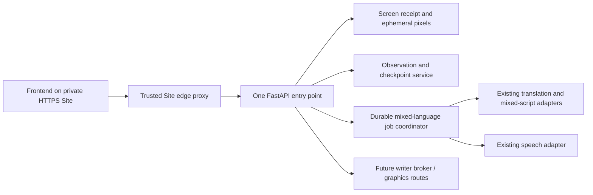

# JSON branch addition

This branch adds `POST /lab-sessions/{lab_id}/check-stream` with the same CheckFrame JSON request and owned SSE response. OpenAPI now has 29 HTTP paths. See [the stream implementation/protocol](../experiments/json-stream-implementation.md). The test Site runs its Worker adapter; Python cloud hosting is still pending. Original nonstream endpoints below remain available.

# Frontend API handoff — unified FastAPI prototype

14 October 2026. Local implementation verified; cloud Python deployment and Site bridge activation pending. Read [the screen baseline](../baselines/screen-reader-v1.md) for the actual user-tested hosted path.

## Entry point and what is live

One Python app now composes capture, lab observation/checkpoint tracking and mixed-language text/audio jobs: [prototypes/backend/app.py](../../prototypes/backend/app.py). All analysis/progress/pipeline orchestration in this app is Python; browser JavaScript captures frames and renders state. The original screen/lab implementation is preserved beneath the composition.

**The private live Site still uses its frozen Worker/D1 backend.** These consolidated endpoints are not yet available there. There is no production FastAPI base URL to give the frontend today. The route-derived [OpenAPI file](../../contracts/frontend.openapi.json) and request examples can be used for frontend bindings and a local/mock integration now; cloud acceptance must precede switching the actual base URL. Do not guess a forwarding URL or claim Sites natively hosts Python.



## Authentication and frontend connection rule

In cloud mode the browser calls the **same private Site origin** with normal credentials. The edge supplies trusted `x-kiki-owner` and `x-kiki-proxy-key`, rewrites Origin, and forwards to one configured HTTPS Python origin. Browser code must never contain either server credential or forge owner identity. The Python `SiteProxyGuard` protects HTTP, WebSocket and private downloads; only data-free `/health` is public.

Local test mode establishes a random HTTP-only owner cookie by opening `/`. All mutating calls require matching Origin/Host. This local capability is not production Kiki account authentication. No permissive CORS is installed. Cloud account/session integration remains the Site proxy until a production authentication design is adopted.

Important edge change: [deploy/sites/python-proxy.js](../../deploy/sites/python-proxy.js) forwards `Idempotency-Key`; the frozen Site proxy did not. Apply this helper to a deliberately authorized Site rollout before connecting jobs. It is a prepared replacement, **not already deployed**. It retains fixed-origin/identity/secret/redirect safeguards. Existing Worker and Python lab projections/stores differ; do not silently combine their state or translate `/action` into Python routes.

## HTTP and WebSocket routes

`lab_id`, `session_id` and `job_id` are opaque returned IDs. Successful lab mutations return the complete current `lab-python/v1` projection. Use the returned revision for the next mutation; on 409 refresh state and reconsider current context.

| Route | Purpose and frontend action |
| --- | --- |
| GET `/health` | Backend/model/configuration readiness, safe key count, separate mixed-language configuration. No keys/private data. |
| GET `/openapi.json`, `/docs` | Runtime schema/docs, protected by the cloud proxy. Static copy committed for handoff. |
| GET `/lab-definition`, `/lab-guidance-policy` | Authored experiment and beginner policy. |
| POST `/screen-sessions` | Create a capture segment; returns `session_id`. |
| WS `/screen-sessions/{session_id}/stream` | Python capture transport, same-origin and owned. Sends lifecycle plus JPEG envelopes/binary; receives connected/receipt/snapshot messages. |
| GET `/screen-sessions/{session_id}/observation` | Receipt JSON; this alone is not lab recognition. |
| GET `/screen-sessions/{session_id}/frame` | Latest received JPEG if retained. |
| GET `/screen-sessions/{session_id}/events?after=0&limit=100` | Ordered paginated receipt events. |
| POST `/screen-sessions/{session_id}/stop` | Explicit capture stop; native browser track also stops on frontend. |
| POST `/lab-sessions` | Start selected model, `operator_trial:true`, explicitly `progression_mode:"screen_guided"`. Default remains reviewed for compatibility. |
| GET `/lab-sessions`, `/lab-sessions/{lab_id}` | Owned runs/current queue/observation/now-next state. |
| POST `/lab-sessions/{lab_id}/attach` | Attach returned capture ID with current revision. |
| POST `/lab-sessions/{lab_id}/check` | `{revision,frame_id,view_revision}` for the latest received trusted frame. This is ordinary bounded JSON, not a streaming endpoint. |
| POST `/lab-sessions/{lab_id}/review` | Explicit saved/run/operator confirmation or reviewed evidence where applicable; named criterion IDs and a review note. |
| POST `/lab-sessions/{lab_id}/responses` | Typed prediction, observation, explanation, question or note; separate from assessed mastery. |
| POST `/lab-sessions/{lab_id}/context` | Pause/resume, declared view/parameter/condition change, revisit, enable guided mode. |
| GET `/lab-sessions/{lab_id}/image` | Latest checked JPEG while current/fresh. |
| GET `/lab-sessions/{lab_id}/frame-handles/{handle_id}` | Exact bound checked pixels + `X-Frame-Provenance`, otherwise 410. For writer integration. |
| GET `/lab-sessions/{lab_id}/events?after=&limit=`, `/export` | Journal pages/full export, owner-scoped. |
| DELETE `/lab-sessions/{lab_id}` | Explicit owned run deletion. |
| POST `/v1/mixed-language-jobs` | Durable admission, **202**, mandatory owner-scoped `Idempotency-Key`, complete prepared source/profile/audio choice. |
| GET `/v1/mixed-language-jobs/{job_id}` | Poll lightweight readiness/stages/links. Suggested initial 1 s polling; stop at terminal status. |
| GET `/v1/mixed-language-jobs/{job_id}/result` | Validated mixed text, source/profile, sentence/spans, speech transcript and provenance once `text_ready`; may precede audio. |
| GET `/v1/mixed-language-jobs/{job_id}/audio` | Owned WAV stream once ready, not base64 in JSON. Full response; range/seek support not implemented. |
| POST `/v1/mixed-language-jobs/{job_id}/retry` | Explicit bounded retry of failed work; reuse validated translation/text stages. |
| POST `/v1/mixed-language-jobs/{job_id}/cancel` | Fence late results, stop future stages; remote provider cancellation is not guaranteed. |
| POST `/mcp` | Existing owned lab read/reset tools; not a public frontend transport or blanket access to user pixels. |

The OpenAPI export includes actual lab request models even though the legacy transport parses bounded bodies manually. WebSocket messages and dynamic lab projections are described here/in existing capture code, not invented as HTTP endpoints. Prepared request examples are in [contracts/examples/frontend](../../contracts/examples/frontend/).

## Screen-guided UI binding

Start the lab; create/share/attach capture; wait for fresh receipt; refresh lab revision immediately before a Python check; submit its exact frame ID/view revision. The existing [capture.js](../../prototypes/screen_capture/static/capture.js), [lab.js](../../prototypes/screen_capture/static/lab.js) and [cadence helper](../../prototypes/screen_capture/static/lab-cadence.js) are the reference client, including WebSocket frame format and lifecycle.

Display tracker `guidance.current_action` and `guidance.next_action`, placement/how-to/settings/expected result, then a separate current observation summary. Do not turn the full criteria ledger into the primary learner checklist or generate new instructions client-side. Automatic progress is server-owned. Respect `retry_at`, one in-flight request, 3 s active floor/12 s idle cadence, latest-frame selection and explicit unknowns. On pause/stop/disconnect/context change, clear old writer marks and provisional observations.

A generic `Analysis off` badge may reflect generic observation disabled while lab guidance owns inference. Show the lab runtime status rather than deriving overall readiness from that badge.

## Mixed-language request and readiness

The source is a full `mixed-script-input/v1` prepared source, with stable sentence IDs, references, glossary and protected literals. It is supplied directly by the owner; the service does not fetch an arbitrary URL or resolve a catalog content ID. It is bounded to 64,000 request bytes and 1–10 source sentences. Both independent finite 0–10 ratings are mandatory numbers; they are learner-selected style preferences, not assessments or language percentages. `audio.enabled` is an explicit boolean. Client-selected provider/model, fixture mode, WPM target and arbitrary voice are not accepted.

```js
const response = await fetch('/v1/mixed-language-jobs', {
  method: 'POST', credentials: 'same-origin',
  headers: {'Content-Type': 'application/json', 'Idempotency-Key': crypto.randomUUID()},
  body: JSON.stringify({source: preparedSource,
    profile: {english_proficiency: 5, odia_proficiency: 7},
    audio: {enabled: true}})
});
const job = await response.json();
// Persist job.job_id/links.status. Retry admission with the SAME key/body if
// the network response is lost; use a new key for a new deliberate request.
```

`queued → translating → refining → text_ready → synthesizing → ready`, with independent stage statuses/readiness. Failed TTS retains usable validated text. A failed refinement does not label the translation draft as finished mixed text. Polling contains no artifact bytes; fetch result once text is ready and audio when its authorized link appears. Render span text with text APIs, retain original sentence IDs, and label human scientific/Odia/pronunciation review pending. `timing_cues:null` means no alignment; never fabricate word/sentence highlighting from estimated duration.

Cancellation fences worker completion and prevents later stages/assets from activating. Existing validated text is still inspectable. Interrupted in-flight jobs become failed and require explicit retry after restart, because a timed-out/interrupted provider may already have done billable work. Queued jobs remain durable. Explicit retry resumes saved stages, at most three job attempts. A changed model/voice policy requires a deliberately new job rather than silently reusing mismatched provenance.

The new generic rating policy is `mixed-language-profile/v1`, layered over the existing preservation prompt. It is structurally/offline tested; no new live language-quality trial was run. The earlier evaluated English-5/Odia-7 prompt is a narrower VCO experiment, not proof of all rating values or all STEM topics.

## Shared setup and remaining integration

```sh
python -m pip install -r prototypes/screen_capture/requirements.txt
python -B -m prototypes.backend --port 8765 --data-dir work/backend
```

A non-secret [runtime variable template](../../deploy/fastapi/runtime.env.example) lists the settings; no .env file is automatically loaded. One process/instance; persistent `KIKI_DATA_DIR`. Screen/lab SQLite and mixed-job SQLite are separate tables/stores under that directory; latest screen pixels are ephemeral, job stages and optional WAV are persistent until operator-managed retention. No automatic artifact TTL/delete endpoint is supplied for mixed jobs in this slice. WAV duration/format/size are bounded by the existing TTS adapter. Blocking text/TTS calls use a dedicated two-thread pool and a durable database-backed queue, not a claim of distributed worker/actor infrastructure. Graceful shutdown fences outputs; in-flight blocking provider work can continue until its transport timeout.

| Runtime setting | Scope |
| --- | --- |
| `GEMINI_API_KEY` | Existing text/TTS credential and single-key screen fallback; server-only. |
| `GEMINI_API_KEYS` | Newer rotating **screen-analysis** pool, supersedes screen fallback. Text/TTS do not yet consume this list. |
| `GEMINI_LAB_MODEL`, `GEMINI_SCREEN_MODEL` | Screen lab/generic model policy. Frozen default 3.5 Flash-Lite. |
| `GEMINI_TEXT_MODEL` | Job text default `gemini-3.5-flash-lite`. CLI retains its separate historical default. |
| `GEMINI_SPEECH_MODEL`, `GEMINI_SPEECH_VOICE` | Job defaults `gemini-3.8-flash-lite-tts` / Kore. |
| `KIKI_PROXY_SECRET`, `KIKI_REQUIRE_PROXY=1` | Backend trusted edge boundary; required cloud startup guard. |
| Site `KIKI_FASTAPI_ORIGIN`, same `KIKI_PROXY_SECRET` | Activate edge only after an actual reachable Python deployment is verified. |
| `PORT`, `KIKI_DATA_DIR` | Cloud listener and persistent directory. |

The [container](../../deploy/fastapi/Dockerfile) now starts the composed app and copies only needed source. Its build/run on the actual host is unverified; no hosting resources or charges were created here. `deploy/fastapi/README.md` explains staged rollout and explicit rollback. Coding-environment and Site production secrets are different; saving keys in one does not configure the other.

Still required before a cloud frontend launch: host one persistent Python instance; verify signed-in HTTP/WebSocket/job/audio isolation through the prepared edge; choose retention/cleanup and production auth; coordinate text/TTS/screen quota and key routing; evaluate the generic profile policy. Future graphics jobs, anchor resolution/cue broker/ACK ingestion, complete view detection and true live overlay are not HTTP endpoints implemented by this slice. Existing `screen-writing/v0.2` contracts remain the renderer handoff; writer success never completes a checkpoint. Keep latency experiments separate from these integration changes.

## Verification boundary

Offline acceptance tests exercise one-app route discovery, real prepared-source validation, owner-scoped idempotency/conflicts, input bounds, profile snapshot, text-before-audio, TTS failure/retry without repeated text calls, restart checkpoint reuse, cancellation of late completion, WAV inspection and cloud owner/proxy protection. Providers are explicit injected fixtures; no paid call, new Site deploy, actual container-host smoke or browser acceptance is implied. Counts and exact checks are in [active.md](../plans/active.md).
